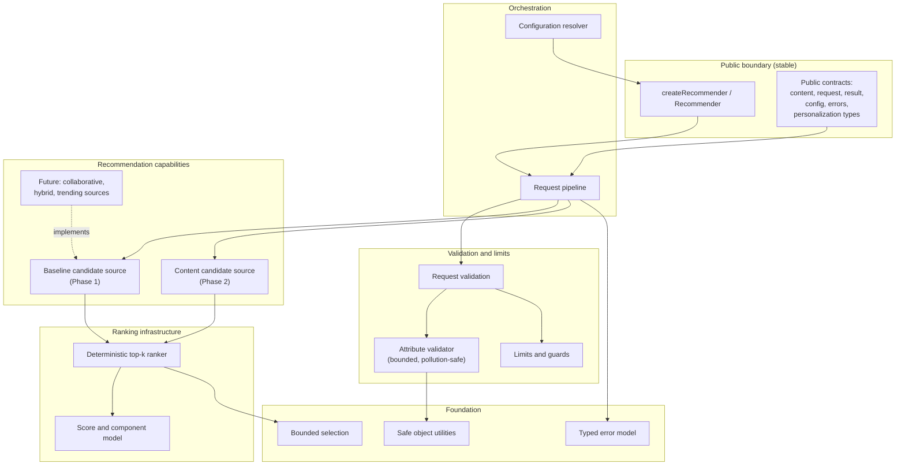
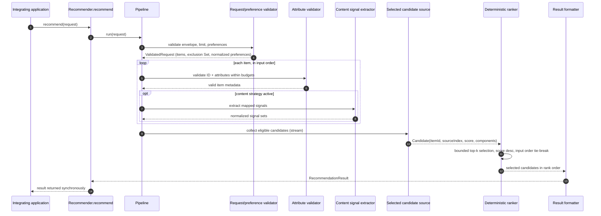

# Recomet Architecture

**Status:** Phase 1 implemented and verified locally. Phase 2 accepted by the maintainer
(2026-11-05; independent audit `APPROVE WITH CONDITIONS`; documented limitations remain visible).
Phase 3 collaborative filtering (collaborative-only) is **accepted** by the maintainer
(2026-11-07; see [`PHASE3_ACCEPTANCE.md`](./docs/development/phase-history/phase-3/PHASE3_ACCEPTANCE.md)). Phase 4 explicit `hybrid` strategy
(availability-aware fusion, implemented subset) is **formally accepted** by the maintainer
(2026-11-07; see [`PHASE4_ACCEPTANCE.md`](./docs/development/phase-history/phase-4/PHASE4_ACCEPTANCE.md)), subject to documented limitations.
Hybrid personalization (`R23`) remains deferred unless separately approved. Phase 5 is not started.
**Version:** 0.1.0 (pre-release)
**Last updated:** 2026-11-07
**Related:** [SPECIFICATION.md](./SPECIFICATION.md), [SECURITY.md](./SECURITY.md), [PRIVACY.md](./PRIVACY.md)

**Historical decision (2026-11-05):** `Phase 3 is collaborative-only. Hybrid recommendations and hybrid personalization are deferred to Phase 4.` (Preserved; Phase 4 implemented subset later authorized and accepted as recorded.)

---

## 1. Architectural Goals

The architecture must:

1. Keep all data processing inside the integrating application.
2. Provide a stable, small public API that does not expose internal algorithms.
3. Let capabilities be added without rewriting the engine.
4. Be storage-agnostic and runtime-independent.
5. Be expressible in language-neutral specifications for future implementations.
6. Make security limits and failure behaviour explicit.
7. Avoid dependencies, global state, background work, and hidden I/O.
8. Make each phase small enough to implement, test, and review thoroughly.

The design follows one rule: **the public boundary is narrow, the internals are replaceable,
and Recomet itself does not transmit application-supplied data out of the process.** The host
application remains in control of its own storage, logging, and network use.

---

## 2. System Context

```mermaid
flowchart LR
    EndUser[End user] -->|interacts| App[Integrating application]
    App -->|content, preferences, signals, request| Engine[Recomet library<br/>in-process]
    Engine -->|ranked recommendations| App
    App -->|renders| EndUser

    App -.->|developer-controlled storage<br/>optional, outside Recomet| Store[(Application database)]
    Engine -.x|no telemetry, no runtime network,<br/>no maintainer access| Maintainers[Recomet maintainers]

    Dev[Developer] -->|installs package via npm| App
```

Key properties:

- Recomet is designed to be embedded in the application process.
- The only intended runtime data flow is application → engine → application.
- There is no intended Recomet-operated server in the request path.
- Optional persistence belongs to the application. Recomet is designed not to own a database.
- Package installation/update uses npm; that is not runtime behaviour.

---

## 3. Layered Structure



Public contracts are exported. Candidate sources, rankers, safe-object utilities, and
pipelines remain internal. They are documented here so they can be stabilized deliberately
rather than accidentally.

---

## 4. Module Responsibilities

Implemented Phase 1 and Phase 2 layout. Boundaries are final for this phase; internal names may
still change without public API impact:

```text
src/
  index.ts                     Public exports only
  engine/
    create-recommender.ts      Factory, config resolution, instance creation
    recommender.ts             Synchronous Recommender implementation
    pipeline.ts                Ordered request-processing pipeline
  contracts/
    index.ts                   Contract re-exports
    content.ts                 ContentItem, AttributeValue
    personalization.ts         PreferenceKind, ContentPreference, RecommendationPreferences,
                               and forward-looking profile types
    request.ts                 RecommendationRequest
    result.ts                  RecommendationResult and related types
    recommender.ts             Public Recommender interface
    config.ts                  RecommenderConfig, EngineLimits, strategies, content config
    errors.ts                  Error codes, categories, details
  content/
    model.ts                   Canonical attribute map, weights, normalization, signal types
    signals.ts                 Bounded mapped-signal extraction and validation
  validation/
    config.ts                  Allowlisted configuration validation
    request.ts                 Request, item, ID, exclusion, and strategy selection validation
    preferences.ts             Preference validation, normalization, dedupe, and limits
    attributes.ts              Bounded JSON-compatible attribute validation
  candidates/
    candidate.ts               Internal Candidate and CandidateSource interfaces
    baseline.ts                Phase 1 baseline candidate source
    content.ts                 Phase 2 content candidate source
  ranking/
    score.ts                   Score components, content scoring, combination, validation
    top-k.ts                   Bounded min-heap selection
    ranker.ts                  Deterministic top-k ranker
  errors/
    recomet-error.ts           RecometError class and safe construction
  internal/
    limits.ts                  Frozen defaults and hard caps
    safe-object.ts             Own-property and plain-object inspections
    id.ts                      ID validation and set construction
```

Tests are flat by topic rather than separated into unit/integration directories:

```text
tests/
  public-api.test.ts           Public surface, baseline behaviour, and content acceptance
  config.test.ts               Configuration validation, strategies, and isolation
  validation.test.ts           Request, item, limit, and exclusion validation
  attributes.test.ts           Attribute validation and resource budgets
  preferences.test.ts          Preference validation, normalization, weights, and limits
  content.test.ts              Content signals, scoring, integration, and explanations
  content-security.test.ts     Preference/content privacy, mutation, and hostile inputs
  ranking.test.ts              Top-k, ranker, score, and baseline source
  security.test.ts             Privacy, mutation, isolation, and result shape
  proxy.test.ts                Hostile-Proxy boundary and limitation coverage
  policy.test.ts               Static runtime-policy and package scan
  regression.test.ts           Comparison with a naive reference implementation
  helpers.ts                   Shared synthetic-data helpers
  browser/
    index.html                 Real-browser harness page
    suite.js                   Browser-side correctness checks
benchmarks/
  run.mjs                      Reproducible synthetic benchmark harness
scripts/
  browser-test.mjs             Installed-browser execution harness
  clean.mjs                    Build-output cleanup
```

No module may import from `engine/` except `engine/` and `index.ts`. Capabilities may depend
on contracts and foundation utilities, never on the public factory. This prevents circular
dependencies and keeps the public API from coupling to algorithms.

---

## 5. Public API Boundary

### 5.1 Exports

```ts
// Factory and instance
export function createRecommender(config?: RecommenderConfig): Recommender;

export interface Recommender {
  recommend(request: RecommendationRequest): RecommendationResult;
}

// Contracts
export type {
  AttributeValue,
  ConfiguredStrategy,
  ContentAttributeMap,
  ContentItem,
  ContentPreference,
  ContentStrategyConfig,
  ContentWeights,
  EngineLimits,
  Interaction,
  Interest,
  PreferenceKind,
  Recommendation,
  RecommendationExplanation,
  RecommendationMetadata,
  RecommendationPreferences,
  RecommendationRequest,
  RecommendationResult,
  RecometErrorCategory,
  RecometErrorCode,
  RecometErrorDetails,
  Recommender,
  RecommenderConfig,
  ScoreComponent,
  ScoreFactor,
  StrategyId,
  UserProfile,
  UserReference,
} from "./contracts/index.js";

export { RecometError } from "./errors/recomet-error.js";
```

### 5.2 Non-exports

The following remain internal:

- Candidate sources and the candidate model.
- Rankers, top-k heap, and internal score combination.
- Content model, signal extraction, and preference normalization.
- Validation functions and safe-object helpers.
- Resolved configuration internals.
- Any strategy registration mechanism.

Rationale: extension APIs are long-lived compatibility promises. They are designed with real
capabilities in each phase, not guessed ahead of implementation.

### 5.3 API behaviour

- `createRecommender` is synchronous, cheap, and throws `RecometError` for invalid config.
- `recommend` is synchronous. It returns a complete `RecommendationResult` directly and throws
  `RecometError` synchronously for invalid requests. The engine performs no I/O, network access,
  background work, or external data adaptation, so no Promise boundary is introduced. The
  decision record is in §5.4.
- Each call is independent. Results are fresh objects owned by the caller; mutating a
  result cannot affect engine state.
- The engine never mutates input arrays or objects.
- Input references beyond the call are not retained.

### 5.4 Synchronous API (decided)

The public API is synchronous:

```ts
const recommender = createRecommender(config);
const result = recommender.recommend(request);
```

Rationale:

- All current processing is in-memory and synchronous; a Promise would add a microtask and an
  unhandled-rejection failure mode without providing any capability.
- Direct return and direct `throw` make error handling simple and match the actual work.
- Hypothetical future asynchronous adapters are not a sufficient reason to complicate the
  initial contract. If they are required later, they should be designed explicitly rather than
  inferred from a Promise-shaped current API.
- The decision does not change current scope. No asynchronous method, queue, worker, or
  adapter is implemented.

Recorded alternatives:

| Option | Outcome |
| --- | --- |
| **Synchronous `recommend()`** | **Selected.** Matches the in-memory architecture; direct `throw`/return; no microtask or unhandled-rejection path. |
| **Promise-based `recommend()`** | Rejected for the current synchronous engine. Adds asynchronous complexity for no current capability. |
| **Hybrid: synchronous now, `recommendAsync()` later** | Not implemented. May be considered separately only if a real asynchronous requirement is approved. |

---

## 6. Common Data Contracts

These are the current public TypeScript definitions. Semantics are language-neutral and
JSON-compatible; TypeScript is the first binding, not the definition of the contract.

### 6.1 Content and attributes

```ts
export type AttributeValue =
  | string
  | number
  | boolean
  | null
  | readonly AttributeValue[]
  | { readonly [key: string]: AttributeValue };

export interface ContentItem {
  readonly id: string;
  readonly attributes?: Readonly<Record<string, AttributeValue>>;
}
```

Rules:

- `id` is opaque, non-empty, case-sensitive, at most `maxIdLength` UTF-16 code units, and
  must not contain U+0000. Recomet never trims, normalizes, parses, or rewrites it.
- Item IDs must be unique within a request.
- `attributes` is an optional plain object containing JSON-compatible values. It is an
  extensibility bag, not a fixed schema. Applications can store tags, categories, titles,
  timestamps, embeddings metadata, or any other JSON-compatible content without changing
  Recomet's database design.
- Numbers must be finite. `NaN`, `Infinity`, and `-Infinity` are invalid.
- Objects must be plain (`Object.prototype` or `null` prototype), use own enumerable string
  keys, and contain no accessor properties, symbols, functions, class instances, or cycles.
  Validation reads own data descriptors and does not invoke accessor getters or `toJSON`.
- JSON-compatible input is the supported boundary for untrusted external data. Arbitrary live
  JavaScript objects, including proxies, are outside that boundary: a proxy cannot be reliably
  detected or safely inspected, and its traps may execute host code, throw, mutate global
  state, or block during inspection. Validation catches and sanitizes inspection failures, but
  it does not guarantee protection against arbitrary code execution or blocking caused by a
  hostile object. See [SECURITY.md §4.4](./SECURITY.md#44-javascript-object-inspection-boundary).
- The keys `__proto__`, `constructor`, and `prototype` are rejected at every object level.
- Depth, node count, per-string length, total nodes, and total characters are bounded.
- Shared object references are treated as invalid (the contract is a tree, not a graph).
- Mapping is explicit. Only attributes named by the resolved `content.attributes` map are
  interpreted as content signals; other attributes are validated and discarded. Mapped values
  must be a string or a dense array of strings. No attribute copy is retained.

### 6.2 Personalization contracts

Phase 2 implements explicit per-request content preferences:

```ts
export type PreferenceKind = "category" | "tag" | "topic" | "keyword" | "contentType";

export interface ContentPreference {
  readonly kind: PreferenceKind;
  readonly value: string; // trimmed, NFC-normalized, lowercased by default
  readonly weight?: number; // finite, > 0, <= 1000; defaults to 1
}

export interface RecommendationPreferences {
  readonly interests: readonly ContentPreference[];
}
```

The following forward-looking types remain exported for compatibility planning but are still
**not accepted by the request** and are not silently ignored:

```ts
export interface UserReference {
  readonly userId: string;
}

export interface Interest {
  readonly key: string;
  readonly weight: number; // finite, normalized by the consuming capability
}

export interface UserProfile extends UserReference {
  readonly interests?: readonly Interest[];
}

export interface Interaction {
  readonly userId: string;
  readonly itemId: string;
  readonly type: string; // "view" | "like" | "save" | "share" | "skip" | "search" | "watch" | "follow" | app-defined
  readonly value?: number; // finite; meaning depends on type (for example seconds watched)
  readonly timestamp?: number; // Unix epoch milliseconds, UTC
  readonly metadata?: Readonly<Record<string, AttributeValue>>;
}
```

Profiles, interaction records, and learned interests require separate validation, quality
evaluation, cold-start behaviour, and privacy review. They are not part of the authorized
Phase 2 implementation.

### 6.3 Request

```ts
export interface RecommendationRequest {
  readonly items: readonly ContentItem[];
  readonly limit?: number;
  readonly excludeItemIds?: readonly string[];
  readonly preferences?: RecommendationPreferences;
}
```

Semantics:

- `items` is required. An empty array is valid and yields an empty successful result.
- `limit` defaults to the resolved `defaultLimit` and must be an integer in `1..maxLimit`.
- `excludeItemIds` filters items by exact ID equality. Duplicates are deduplicated for
  matching. Exclusions that match nothing are harmless.
- `preferences` is optional. When present it must be a plain object containing only an
  `interests` array. An empty array is valid and selects the baseline fallback.
- Unknown request, preference, and interest keys are rejected.
- No user ID, profile, or interaction record is accepted.

### 6.4 Configuration

```ts
export type StrategyId = "baseline" | "content";
export type ConfiguredStrategy = StrategyId | "auto";

export interface EngineLimits {
  readonly maxItems: number;
  readonly maxExcludeItemIds: number;
  readonly maxLimit: number;
  readonly defaultLimit: number;
  readonly maxIdLength: number;
  readonly maxAttributeNodesPerItem: number;
  readonly maxAttributeDepth: number;
  readonly maxAttributeStringLength: number;
  readonly maxTotalAttributeNodes: number;
  readonly maxTotalAttributeCharacters: number;
  readonly maxPreferenceTerms?: number;
  readonly maxPreferenceValueLength?: number;
  readonly maxSignalValuesPerItem?: number;
}

export type ContentAttributeMap = Readonly<Partial<Record<PreferenceKind, string>>>;
export type ContentWeights = Readonly<Partial<Record<PreferenceKind, number>>>;

export interface ContentStrategyConfig {
  readonly attributes?: ContentAttributeMap;
  readonly weights?: ContentWeights;
  readonly caseSensitive?: boolean;
}

export interface RecommenderConfig {
  readonly strategy?: ConfiguredStrategy;
  readonly limits?: Partial<EngineLimits>;
  readonly content?: ContentStrategyConfig;
}
```

Configuration rules:

- Only `strategy`, `limits`, and `content` are accepted.
- `strategy` accepts `"auto"` (default), `"baseline"`, and `"content"`. Unknown or
  not-yet-implemented values throw `UNSUPPORTED_STRATEGY`.
- `content.attributes` maps preference kinds to attribute keys. Omitted kinds use the defaults
  `category`, `tags`, `topics`, `keywords`, and `contentType`. Keys and values must be valid
  non-empty strings; unknown kinds are rejected.
- `content.weights` sets positive finite factor weights. Omitted kinds default to `1`.
- `content.caseSensitive` defaults to `false`. When false, labels are trimmed, NFC-normalized,
  and lowercased.
- Every provided limit must be a safe integer within its hard ceiling.
- If `defaultLimit` is omitted, it resolves to the smaller of `10` and `maxLimit`; if it is
  provided, it must not exceed `maxLimit`.
- Unknown nested keys are rejected.
- Values are never clamped silently.
- The resolved configuration is frozen and contains no references to caller-owned objects.
- `createRecommender` validates before returning an instance.

### 6.5 Result

```ts
export interface RecommendationResult {
  readonly strategy: StrategyId;
  readonly recommendations: readonly Recommendation[];
  readonly metadata: RecommendationMetadata;
}

export interface Recommendation {
  readonly itemId: string;
  readonly rank: number; // 1-based
  readonly score: number; // finite, 0..1
  readonly explanation: RecommendationExplanation;
}

export type ScoreFactor = "baseline" | PreferenceKind;

export interface ScoreComponent {
  readonly factor: ScoreFactor;
  readonly value: number; // normalized 0..1
  readonly weight: number; // finite, >= 0 (raw weight; normalized during combination)
  readonly contribution: number; // value * normalized weight, 0..1
}

export interface RecommendationExplanation {
  readonly strategy: StrategyId;
  readonly summary: string;
  readonly components: readonly ScoreComponent[];
}

export interface RecommendationMetadata {
  readonly totalItems: number;
  readonly eligibleItems: number;
  readonly excludedItems: number;
  readonly returnedItems: number;
  readonly limit: number;
}
```

Formatting rules:

- Recommendations are ordered by rank ascending.
- `score` is the sum of component contributions and stays within `[0, 1]`.
- The baseline explanation is exactly attributable: one component with factor `baseline`,
  value `0.5`, weight `1`, contribution `0.5`, and a summary stating that no personalization
  or relevance model was applied.
- A content explanation has one component per active preference kind in the fixed order
  `category`, `tag`, `topic`, `keyword`, `contentType`. `value` is the weighted coverage for
  that kind, `weight` is the configured raw factor weight, and `contribution` is the
  normalized share. Its summary states that explicit preferences were used and no interaction
  history was used.
- Content scores are relevance values. An item with no matching signals scores `0`, not `0.5`.
- Only item IDs are echoed. Attributes, preference labels, user IDs, interactions, and raw
  input references do not appear in results.
- Metadata counts are computed from validated input, not estimated.

### 6.6 Errors

```ts
export type RecometErrorCategory =
  | "configuration"
  | "validation"
  | "limit"
  | "internal";

export type RecometErrorCode =
  | "INVALID_CONFIG"
  | "UNSUPPORTED_STRATEGY"
  | "INVALID_REQUEST"
  | "INVALID_ITEM"
  | "DUPLICATE_ITEM_ID"
  | "INVALID_LIMIT"
  | "INVALID_PREFERENCES"
  | "LIMIT_EXCEEDED"
  | "INTERNAL_ERROR";

export interface RecometErrorDetails {
  readonly index?: number;
  readonly path?: string; // fixed field names and numeric indexes only
  readonly limit?: number;
}

export class RecometError extends Error {
  readonly code: RecometErrorCode;
  readonly category: RecometErrorCategory;
  readonly details?: RecometErrorDetails;
}
```

Error invariants:

- No input values, ID values, attribute keys, preference values, or raw objects in messages
  or details.
- `path` uses known field names and numeric indices, for example `items[4].attributes`.
- Internal failures are wrapped once as `INTERNAL_ERROR`; later phases must not expose stack
  traces through messages.
- Errors are never logged by the library.

---

## 7. Request-Processing Flow



The API is synchronous; see §5.4 for the recorded decision.

### 7.1 Ordered stages

1. **Configuration is trusted.** It was validated at instance creation, frozen, and is not
   re-read from mutable input.
2. **Request envelope validation.** Plain object, allowlisted keys, array shape, limit type
   and range, exclusion array shape and size, and optional preference validation.
3. **Strategy selection.** `auto` chooses content scoring only when normalized preferences
   exist; `baseline` rejects supplied preferences; `content` falls back to the baseline when
   no usable preference remains.
4. **Item validation.** IDs, duplicates, attribute budgets, prototype safety. Validation
   iterates once and does not clone content. When content scoring is active, only mapped
   signal attributes are extracted and normalized.
5. **Candidate generation.** Iterate items in input order; skip excluded IDs. A generator
   streams candidates rather than materializing the full candidate array.
6. **Ranking.** Combine components, keep only the best `limit` candidates in a bounded
   min-heap, then sort the final set. The heap itself is O(`k`), but total auxiliary memory is
   **not** O(`k`): duplicate-ID tracking is O(`n`), exclusion tracking is O(`e`),
   attribute-graph tracking is O(`a`), and preference tracking is O(`p`). See §9.3.
7. **Formatting.** Build a fresh result with item IDs, ranks, normalized scores,
   explanations, and metadata.
8. **Return.** Return the result synchronously. No cache is updated, no event is emitted,
   nothing is written.

### 7.2 Failure points

| Stage | Failure | Outcome |
| --- | --- | --- |
| Initialization | Invalid or unsupported config | Throws `RecometError` synchronously |
| Request | Not an object / unknown key / malformed array | Throws `INVALID_REQUEST` |
| Request | Limit invalid or out of range | Throws `INVALID_LIMIT` |
| Preferences | Malformed preferences, unknown kind, invalid value or weight | Throws `INVALID_PREFERENCES` |
| Preferences | Too many terms | Throws `LIMIT_EXCEEDED` |
| Request | `preferences` supplied with explicit `baseline` strategy | Throws `INVALID_REQUEST` |
| Items | Too many items or exclusions | Throws `LIMIT_EXCEEDED` |
| Items | Missing/invalid ID | Throws `INVALID_ITEM` |
| Items | Duplicate ID | Throws `DUPLICATE_ITEM_ID` |
| Items | Attribute budget exceeded / unsafe value | Throws `LIMIT_EXCEEDED` or `INVALID_ITEM` |
| Items | Mapped signal is not a string or dense string array | Throws `INVALID_ITEM` |
| Items | Too many values in one mapped signal | Throws `LIMIT_EXCEEDED` |
| Any unexpected failure | Bug, proxy trap, inspection failure, allocation failure | Throws `INTERNAL_ERROR` (safe message) |

Partial results are never returned on error. Processing is deterministic; a request either
yields a complete validated result or no result. A sanitized `INTERNAL_ERROR` does not imply
that a hostile proxy trap was contained: the trap may already have executed host code or
blocked before the error was raised (see [SECURITY.md §4.4](./SECURITY.md#44-javascript-object-inspection-boundary)).

---

## 8. Configuration Defaults and Hard Caps

Defaults favour safety and small/medium applications. All values are safe integers.
Hard caps are absolute and cannot be raised through configuration.

**Status: provisional, benchmarked on a limited set.** Every default and hard cap below was
proposed in Phase 0. Phase 1 and Phase 2 recorded synthetic measurements on one reference
machine (2026-11-05): Node.js `v24.18.0`, Windows x64, Intel Core i3-1125G4 @ 2.00 GHz,
8 logical CPUs, 8 GB RAM. The initial p95 time budgets were met for 1,000 items/limit 10,
10,000 items/limit 10, and 10,000 items/limit 100 with no attributes. Content workloads were
measured but have no time budget. Peak memory was **not** measured, the attribute-heavy
default budgets were not shown to fit typical payloads, and no value below is described as
optimal or guaranteed. See SPECIFICATION §10.2 for the table and methodology.

| Limit | Default | Minimum | Hard maximum | Purpose |
| --- | ---: | ---: | ---: | --- |
| `maxItems` | 10,000 | 1 | 100,000 | Bound per-request item count. |
| `maxExcludeItemIds` | 10,000 | 0 | 100,000 | Bound exclusion list size. |
| `maxLimit` | 100 | 1 | 1,000 | Bound returned recommendations. |
| `defaultLimit` | 10 (or `maxLimit` if lower) | 1 | `maxLimit` | Default result size. |
| `maxIdLength` | 256 | 1 | 1,024 | Bound ID size in UTF-16 code units. |
| `maxAttributeNodesPerItem` | 256 | 1 | 1,024 | Bound per-item attribute tree. |
| `maxAttributeDepth` | 4 | 1 | 8 | Bound nesting depth. |
| `maxAttributeStringLength` | 4,096 | 1 | 65,536 | Bound individual strings and keys. |
| `maxTotalAttributeNodes` | 50,000 | 1 | 500,000 | Bound total attribute work per request. |
| `maxTotalAttributeCharacters` | 1,000,000 | 1 | 5,000,000 | Bound total attribute text per request. |
| `maxPreferenceTerms` | 256 | 1 | 10,000 | Bound explicit preference entries per request. |
| `maxPreferenceValueLength` | 256 | 1 | 4,096 | Bound each preference label in UTF-16 code units. |
| `maxSignalValuesPerItem` | 64 | 1 | 1,024 | Bound values read from one mapped signal attribute. |

Notes:

- The total budgets are accumulated across all items and stop validation early when
  exceeded. This prevents `maxItems × maxAttributeNodesPerItem` worst cases.
- The top-k heap is bounded by `maxLimit` (hard cap 1,000), independent of item count. This
  bounds only the heap; duplicate-ID, exclusion, attribute-graph, and preference tracking add
  O(`n`), O(`e`), O(`a`), and O(`p`) auxiliary state respectively.
- Content scoring reads only mapped attributes. A mapped attribute may be a string or a dense
  array of strings; each item's mapped values are bounded by `maxSignalValuesPerItem`.
- IDs also consume memory proportional to `items × maxIdLength`; the hard item cap limits
  this. Integrators raising caps accept a larger resource envelope explicitly.
- The recorded measurements cover time only for the scenarios in SPECIFICATION §10.2. Peak
  additional engine memory was not measured; after-call GC samples are not a peak-memory
  substitute. The 10,000-item, 20-attribute and content scenarios required raising both total
  attribute budgets to the hard caps, so the default total budgets are deliberately
  conservative and may reject attribute-heavy payloads until configured.
- These numbers remain provisional proposals, not validated optima or performance guarantees.
  They require maintainer approval and further evidence before being described as validated.

---

## 9. Ranking Infrastructure

### 9.1 Interfaces (internal)

```ts
interface Candidate {
  readonly itemId: string;
  readonly sourceIndex: number;
  readonly score: number; // 0..1
  readonly components: readonly ScoreComponent[];
}

interface CandidateSource {
  readonly id: StrategyId;
  collect(context: CandidateContext): Iterable<Candidate>;
}

interface Ranker {
  readonly id: string;
  select(candidates: Iterable<Candidate>, limit: number): Candidate[];
}
```

`CandidateSource` separates "where candidates come from" from "how they are ordered".
There are two sources: `baseline` and `content`. The pipeline selects one based on
configuration and whether normalized preferences are present. Future capabilities add sources
without changing the public request/result envelope where possible.

### 9.2 Score model

- Component: `{ factor, value, weight, contribution }`.
- `value ∈ [0, 1]`, raw `weight ≥ 0`.
- Normalized weight = `weight / Σ(weights)` when `Σ(weights) > 0`; otherwise 0.
- `contribution = value × normalizedWeight`, so every contribution is in `[0, 1]`.
- Total score = `Σ(contributions)`, which is in `[0, 1]`.
- Baseline: one component, `value = 0.5`, raw `weight = 1`, normalized weight 1, total `0.5`.
- Content: for each active preference kind `j`, `V_j = M_j / T_j`, where `M_j` is the summed
  weight of matching preference terms and `T_j` the summed weight of all terms of that kind.
  With configured factor weights `W_j`, the score is `Σ(W_j × V_j) / Σ(W_j)` over active
  kinds. Missing signals contribute `0`. Kind values and the total stay in `[0, 1]`.
- Content explanations emit one component per active kind in fixed order `category`, `tag`,
  `topic`, `keyword`, `contentType`.
- Future factors (freshness, popularity, interaction, diversity) will be added only with
  implemented strategies and their own tests. They are not accepted as config or emitted in
  results before then.
- All score math uses deterministic double-precision arithmetic. Test vectors define
  tolerances for cross-language comparison.

### 9.3 Deterministic top-k

- Ordering: higher score first; equal scores retain original input order (`sourceIndex`).
- The heap stores the current best `limit` candidates, evicting the worst.
- Final output is sorted by the same total order and assigned 1-based ranks.
- No random shuffling, locale comparison, clock reads, or unstable comparison assumptions.
- Time complexity: O(`n` + `e` + `a` + `p` + `n` log `k`), where `n` is the number of
  supplied items, `e` the number of exclusion IDs, `a` the number of attribute values and
  keys inspected, `p` the number of normalized preference terms, and `k` the effective limit.
- Auxiliary-memory complexity: O(`n`) duplicate-ID tracking, O(`e`) exclusion tracking,
  O(`a`) attribute-graph tracking, O(`p`) normalized preferences, O(`k`) top-k heap, plus
  O(`k` × factor count) returned explanation objects.
- Total auxiliary memory is O(`n` + `e` + `a` + `p` + `k`), excluding caller-owned input and
  the returned result. It is **not** O(`k`) alone.
- `k` is at most 1,000 by hard cap; `n`, `e`, `a`, and `p` are bounded by the limits in §8.

### 9.4 Baseline and content strategies

The neutral `0.5` baseline remains the foundation and the documented fallback when no usable
preferences are supplied. It is not personalized relevance. Retaining it:

- Exercises the full pipeline, score, explanation, and limit contracts honestly.
- Avoids pretending an untested heuristic is a recommendation algorithm.
- Provides a defined fallback that the content strategy can use explicitly.
- Is clearly identified in the result so callers cannot confuse it with personalization.

Phase 2 adds an explicit content strategy. It ranks by overlap between caller-supplied
preferences and mapped item labels, with no interaction history, learning, profiles, or
similarity. It is deterministic and explainable, but it has **not** been evaluated against a
recommendation-quality benchmark.

---

## 10. Node.js and Browser Compatibility Strategy

### 10.1 Runtime rules

- Standard ECMAScript only; target ES2022.
- No Node.js built-ins in runtime modules: no `node:*`, `Buffer`, `process`, `fs`, `path`,
  `crypto`, `http`, `worker_threads`.
- No DOM, `window`, `document`, `localStorage`, or browser-only API in core.
- No dynamic code execution: no `eval`, `new Function`, or remote dynamic imports.
- No WebAssembly requirement.
- No install scripts, native addons, or post-install downloads.

### 10.2 Build and package

Implemented shape (Q3 decided; ESM-only):

```jsonc
{
  "name": "@recomet/core",
  "type": "module",
  "main": "./dist/index.js",
  "types": "./dist/index.d.ts",
  "exports": {
    ".": {
      "types": "./dist/index.d.ts",
      "import": "./dist/index.js",
      "default": "./dist/index.js"
    }
  },
  "sideEffects": false,
  "engines": { "node": ">=22" },
  "dependencies": {}
}
```

- TypeScript emits ESM and declarations.
- CommonJS is not provided. It would only be added with an explicit `require` export, separate
  declarations, and dual-package-hazard review.
- No runtime bundler is required for Node.js; browser consumers use their own bundler or
  native ESM.
- `npm pack --dry-run --json` was inspected for Phase 2: the package contains the ESM build,
  declarations, `package.json`, `LICENSE`, and `README.md`, with no source maps, local paths,
  secrets, install scripts, or unexpected files.
- `dist/` is a build artifact and is not intended for version control.

### 10.3 Verification

- **Node.js:** Phase 2 executed the unit/integration suite and type check with Node.js
  `v24.18.0` (reference runtime) and Node.js `v22.23.4` (temporary `npx node@22` runtime). Both
  passed all 197 tests. The declaration is `engines.node >=22`; no broader version matrix was
  executed.
- **Browser:** Phase 2 executed the built ESM entry in real installed browsers, not only a DOM
  shim, against the browser suite in `tests/browser/`. Results on 2026-11-05: Microsoft Edge
  `156.0.4314.58`, Google Chrome `156.0.8078.80`, and Mozilla Firefox `160.0` each passed 18/18
  checks. Firefox was driven through its WebDriver BiDi remote agent; Chromium browsers used
  headless `--dump-dom`. Safari and WebKit were not available or executed and are **unverified**.
  A WebKit-based headless runner would not be Safari verification; it does not reproduce
  Safari's full browser, OS integration, JIT, or version-specific behaviour.
- **Bundle hygiene:** the static policy test scans `src/` for relative-only imports, Node
  built-ins, network APIs, process access, storage APIs, and dynamic code. It also checks ESM,
  Node `>=22`, zero runtime dependencies, and the package file allowlist.
- **CI (future):** no CI service is configured yet. Local results are recorded per phase; a
  matrix across Node.js versions and browsers remains a later task.

---

## 11. Storage-Agnostic Design

Recomet is designed not to own or require storage.

- Phases 1 and 2 accept item arrays and preferences per request. There is no adapter,
  connection, migration, or schema.
- The engine keeps no cross-request cache, including no preference or profile store. Every call
  supplies current data and preferences.
- Future async adapters may fetch candidates from developer-owned storage, but:
  - they are explicit configuration;
  - they never point at maintainer infrastructure by default;
  - they are implemented by the integrating developer or a reviewed package;
  - the core engine remains usable without them.
- Future persistence must be off by default, documented, and never able to silently
  transmit data to Recomet maintainers.
- "Storage-agnostic" also means Recomet does not assume SQL, NoSQL, files, browser storage,
  or a particular record shape. Applications map their records into `ContentItem` and the
  relevant contracts.

---

## 12. Multi-Language Strategy

Future implementations (for example Python, Rust, Go, Java) will be **separate native
implementations**, not wrappers around TypeScript and not cross-compiled source imports.

Shared artifacts:

1. **Specification:** semantics, ordering, validation, limits, error codes, and capability
   definitions.
2. **Data contracts:** language-neutral JSON-compatible definitions (JSON Schema or a
   documented equivalent) with versioning.
3. **Common test vectors:** JSON/JSONL cases containing input, configuration, expected
   output or error code, ordering, and numeric tolerances.
4. **Benchmark method:** dataset shape, operations, measurement rules; results remain
   language- and hardware-specific and are not transcribed as universal claims.

Rules:

- No language implementation imports TypeScript source or depends on Node.js.
- Idiomatic public APIs may differ per language, but shared semantics and error codes must
  match the vectors.
- Contract version changes are explicit and coordinated.
- Recomet's maintainers decide which implementations are official; unofficial ports must
  not imply endorsement.
- Test vectors are versioned with the contract, not with one package release alone.

Phase 1 establishes TypeScript as the reference implementation; Phase 2 extends it with
content semantics; Phase 5 formalizes shared vectors and cross-language release gates.

---

## 13. Extension Strategy

Phase 2 intentionally exposes no plugin registration. Extension points are designed only
when there is a real capability to exercise them.

Future extension principles:

- Extensions implement documented interfaces; they do not patch internals or monkey-patch
  public objects.
- Extension contracts are versioned and validated.
- Extensions cannot enable network access, filesystem access, telemetry, dynamic code
  loading, or unbounded resource use in core.
- No remote plugin loading.
- Custom rankers and strategies must be explicit in configuration and identified in results.
- A plugin that fails validation must fail safely without corrupting other instances.
- Public extension APIs require security review, documentation, tests, and a compatibility
  policy before release.

Likely future seams (not current public API): candidate sources, feature extractors,
similarity metrics, rankers/weight profiles, and developer-controlled storage adapters.

---

## 14. Security Architecture Summary

Detailed controls are in [SECURITY.md](./SECURITY.md).

- All public input is untrusted and validated against allowlists and budgets.
- Free-form attributes use bounded, own-property, data-descriptor traversal with
  prototype-pollution keys rejected.
- Explicit preferences use the same plain-object, dense-array, own-key inspection. Cycles,
  sparse arrays, symbols, accessors, and prototype-pollution keys are rejected without
  invoking getters.
- IDs are indexed with `Set`/`Map`, never plain objects keyed by user data.
- No `Object.assign`, deep merge, or spread of untrusted objects into internal state.
- No dynamic code execution, filesystem access, network access, or environment reads.
- Top-k heap memory is O(`k`) and bounded by configuration; total auxiliary memory is
  O(`n` + `e` + `a` + `p` + `k`), with item, exclusion, attribute, and preference work bounded
  per request.
- JSON-compatible input is the supported boundary for untrusted data. Proxies cannot be
  reliably detected or safely inspected; Proxy traps may execute, throw, mutate state, or
  block during inspection, and a sanitized `INTERNAL_ERROR` is not proof of containment.
- Cross-realm arrays and plain objects (for example from another `iframe` or `vm` context) are
  rejected by the strict prototype checks. Callers must pass values created in the current
  realm. This is a documented limitation, not a security guarantee.
- Errors are typed and value-free; preference values, content labels, and internal errors are
  not exposed.
- Runtime dependencies are targeted at zero; any dev dependency is reviewed and locked.
- No telemetry or logging is permitted by construction.

---

## 15. Architecture Decision Records

| ID | Decision | Rationale | Status |
| --- | --- | --- | --- |
| ADR-001 | Library embedded in the host application, never a hosted service. | Core privacy and product requirement. | Accepted — Phase 0 |
| ADR-002 | TypeScript reference implementation, standard ECMAScript, Node.js + browser. | Approved requirement R1/R2. | Accepted — Phase 0 |
| ADR-003 | Zero runtime dependencies; standard library only. | Minimal attack surface and footprint. | Accepted — Phase 0 |
| ADR-004 | Phase 1 is the Core Engine Foundation with a neutral baseline only; no relevance algorithm. | Honest foundation; avoids unverified claims. | Accepted — Q5 |
| ADR-005 | `recommend` is synchronous and returns a `RecommendationResult` directly; errors are thrown synchronously. | Matches the in-memory architecture; avoids an unnecessary Promise boundary. See §5.4. | Accepted — Q4 |
| ADR-006 | Results echo item IDs and scores only, not content or user data. | Data minimization. | Accepted — Phase 0 |
| ADR-007 | No public extension API in Phase 1. | Avoid premature, unsupported compatibility promises. | Accepted — Phase 0 |
| ADR-008 | No global mutable state; configuration captured and frozen per instance. | Isolation, concurrency safety, predictable tests. | Accepted — Phase 0 |
| ADR-009 | Bounded streaming candidate generation, O(`k`) top-k heap, and bounded O(`n` + `e` + `a`) request tracking. | Avoid full-collection copies and unbounded memory; does not claim O(`k`) total memory. | Accepted — Phase 0 |
| ADR-010 | ESM-only package; no CommonJS output unless a concrete requirement is approved. | Simpler package, fewer build dependencies. | Accepted — Q3 |
| ADR-011 | Content scoring uses explicit per-request preferences and mapped label attributes only. | Implements the authorized Phase 2 subset without interaction learning, profiles, or similarity. | Accepted — Phase 2 |
| ADR-012 | Content score is weighted coverage over active preference kinds; missing signals score `0`. | Deterministic, explainable pure relevance with no hidden neutral matches. | Accepted — Phase 2 |
| ADR-013 | `auto` selects content only when usable preferences exist; `baseline` rejects supplied preferences. | Makes fallback explicit and prevents silently ignored personalization data. | Accepted — Phase 2 |

---

## 16. Implementation Boundary (Phases 1 and 2)

### Phase 1 included

- Factory, instance, immutable resolved config.
- Public contracts for content, request, result, scores, config, errors, and forward-looking
  personalization types.
- Request and attribute validation with explicit limits.
- Neutral baseline candidate source.
- Score component model and deterministic bounded ranker.
- Safe typed errors.
- Unit, integration, edge-case, and security tests.
- Node.js and browser verification.
- Benchmarks with recorded conditions.
- Documentation matching the implementation.

### Phase 2 included

- Optional per-request explicit preferences with five label kinds and positive weights.
- Developer attribute mappings, factor weights, and optional case-sensitive matching.
- Bounded mapped-signal extraction and normalization.
- Deterministic weighted-coverage content scoring with per-kind explanation components.
- Strategy selection (`auto`, `baseline`, `content`) and explicit baseline fallback.
- Preference/content limits and the `INVALID_PREFERENCES` error code.
- Preference/content validation, security, privacy, integration, and browser tests.

### Included in Phase 3 implementation (collaborative-only, final maintainer review pending)

- Request fields `userId` and `interactions` (explicitly supplied per call) for collaborative
  filtering; interaction records validated as plain objects with bounded IDs/type and finite,
  non-negative `value` when provided (negative values rejected with `INVALID_INTERACTION`; no
  dislike/negative-feedback semantics in Phase 3).
- Effective strength precedence: explicit `value` > configured `interactionTypes[type]` >
  default `1`. Unknown but valid unconfigured interaction `type` defaults to `1` when `value`
  is absent. Duplicate `(userId, itemId)` interactions are summed deterministically.
- Normalization (Decision A): denominator floor is `1`; strengths with absolute value `<= 1`
  retain magnitude (no all-below-1 rescaling to max `1`); when observed max absolute strength
  `> 1`, normalize relative to that maximum. Values remain finite and bounded.
- Collaborative strategies/methods: user-based and item-based neighborhood filtering with
  cosine/Jaccard similarity, configurable interaction-type weights, min overlap, and bounded
  neighbors.
- Strategy handling: `baseline`, `content`, `collaborative`, `auto`; auto selects one applicable
  strategy (no silent blending). Explicit collaborative falls back to content or baseline with
  accurate strategy/explanations (never labeled collaborative).
- Deterministic scoring/ranking, exclusion of target-user interacted items, cold-start/
  insufficient-data handling, and `INVALID_INTERACTION` errors.
- Interaction data processed in memory for the current call only; no retention/persistence/
  collection/telemetry/network.

### Still excluded (Phase 4+)

- Hybrid recommendations (`R12`) and hybrid personalization (`R23`), hybrid strategy/weighting,
  content-collaborative score blending.
- Content similarity/similar-item endpoints, embeddings, fuzzy matching.
- Automatic interaction collection/learning, persistent profiles, cross-application sharing.
- Popularity, trending, freshness, time decay, diversity, advanced ranking profiles.
- Persistence adapters, hosted APIs/backends, telemetry, analytics, network services.

### Implementation status (2026-11-06, this worktree; Phase 3 audit resolution applied)

- **Implemented:** Phase 1 and Phase 2 accepted scope plus Phase 3 collaborative-only filtering,
  built/tested as `@recomet/core@0.1.0` (unpublished). **Formal Phase 3 acceptance is pending
  final maintainer review.** Phase 4 has not started. Zero runtime dependencies; ESM output.
- **Phase 3 audit resolution (2026-11-06):** F-02 normalization semantics preserved and documented
  (denominator floor `1`; no all-below-1 rescaling). F-03 explicit `interaction.value` validated
  as finite non-negative (negative rejected, `INVALID_INTERACTION`; no dislike semantics in Phase 3).
  F-04 unknown valid interaction types default to strength `1` when `value` absent (documented/tested).
  Historical evidence labeling and current-status documentation corrected (F-01).
- **Pre-correction audit evidence (historical, 2026-11-06 audit):** `npm test` reported 13 test
  files, 224 tests passed before these corrections. Treat as audit baseline, not post-correction.
- **Post-correction verification (2026-11-06, this worktree):** `npm run typecheck` PASS;
  `npm run lint` PASS; `npm run format:check` PASS; `npm test` PASS (**13 test files, 239 tests
  passed, 0 failed, 0 skipped**); `npm run build` PASS (regenerated gitignored `dist/`);
  `npm audit --omit=dev` PASS (`found 0 vulnerabilities`); `npm audit` (read-only, no fixes)
  reported **10 moderate** dev-only vulnerabilities (`minimatch` `GHSA-g3hv-75wg-m249`,
  ESLint/typescript-eslint chain), 0 high/critical. Browser tests, benchmarks, Safari/WebKit,
  OS-level network isolation, and peak-memory profiling were not re-run/verified in this task.
- **Browsers:** prior recorded runs (Edge 156/18 checks, Chrome 156/18, Firefox 160/18) remain
  historical evidence for the pre-correction worktree state where recorded; Safari/WebKit remain
  unverified. Browser tests were not re-run in this resolution task.
- **Benchmarks:** not re-run in this resolution task (benchmark command can overwrite ignored
  artifacts). Prior recorded synthetic benchmarks remain historical; peak memory unmeasured;
  limits provisional.
- **Audit:** `npm audit --omit=dev` should report 0 vulnerabilities for runtime deps (zero runtime
  deps). Full `npm audit` may report development-only `minimatch`/ESLint-chain findings
  (`GHSA-g3hv-75wg-m249`, tracked/open); no unsafe fixes applied.
- **Still pending:** final maintainer review and formal Phase 3 acceptance; Safari/WebKit
  execution; peak-memory validation; recommendation-quality evaluation; published-package
  verification. Do not claim Phase 4, release readiness, or publication.

---

## 17. Resolved Decisions and Pre-Release Actions

Q1–Q13 are resolved for Phases 1 and 2. The decision detail is recorded in
[SPECIFICATION.md §15](./SPECIFICATION.md#15-decisions-and-pre-release-actions). Pre-release
actions that remain are:

1. **Q1 Package identity:** confirm `@recomet/core` ownership and availability before
   publication; do not claim the scope is secured.
2. **Q2 Ownership:** finalise the copyright holder and any `NOTICE` content before the first
   public release.
3. **Q6 Browser evidence:** Phase 2 executed Edge, Chrome, and Firefox on Windows and reported
   results per browser. Safari and WebKit remain unverified. WebKit runner results must not be
   described as Safari verification; unexecuted browsers remain unverified.
4. **Q7 Reporting:** verify that GitHub private vulnerability reporting is enabled before relying
   on it; do not invent a contact or guaranteed response times.
5. **Q8 Maintainers:** record named maintainers and release approvers when appointed.
6. **Q9 Limits:** Phase 2 recorded synthetic time measurements and met the initial no-attribute
   p95 budgets. Content scenarios were measured without a time budget. Peak memory was not
   measured and attribute-heavy defaults were not validated; revise defaults and hard caps
   only with further recorded evidence. No value is a performance guarantee.
7. **Q11 Datasets:** record provenance and licence for any future external dataset.
8. **Q12 Persistence:** any persistence proposal requires a separate approved design and review.

No Phase 1 or Phase 2 design decision remains open.

These questions are also tracked in
[SPECIFICATION.md §15](./SPECIFICATION.md#15-decisions-and-pre-release-actions).
