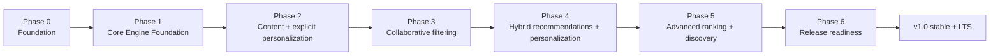

# Recomet Roadmap

**Status:** Phase 0 finalised. Phase 1 implemented and verified locally. Phase 2 accepted by the
maintainer (2026-11-05, independent audit `APPROVE WITH CONDITIONS`; documented limitations remain
visible). Phase 3 collaborative filtering (collaborative-only) is **accepted** by the maintainer
(2026-11-07, independent audit `APPROVE WITH CONDITIONS`; see [`PHASE3_ACCEPTANCE.md`](./docs/development/phase-history/phase-3/PHASE3_ACCEPTANCE.md)). Phase 4
hybrid recommendation (explicit strategy, availability-aware fusion, implemented subset) is
**formally accepted** by the maintainer (2026-11-07, independent audit `APPROVE WITH CONDITIONS`;
F-01/C-01 remediated with exact G1–G10 golden-vector tests; see [`PHASE4_ACCEPTANCE.md`](./docs/development/phase-history/phase-4/PHASE4_ACCEPTANCE.md),
[`PHASE4_FINAL_ACCEPTANCE_AUDIT.md`](./docs/development/phase-history/phase-4/PHASE4_FINAL_ACCEPTANCE_AUDIT.md), [`PHASE4_ACCEPTANCE_REVIEW.md`](./docs/development/phase-history/phase-4/PHASE4_ACCEPTANCE_REVIEW.md)). Documented limitations remain
(deferred dedicated hybrid benchmarks; Safari/WebKit, OS-level network isolation, peak memory, and
worst-case hard-limit performance unverified; 10 moderate development-only npm audit advisories
tracked; JS proxy inspection not sandboxed; additive hybrid strategy may require exhaustive-switch
updates). Hybrid personalization (`R23`) remains deferred unless separately approved. Phase 5 not
started and requires separate maintainer authorization.
**Last updated:** 2026-11-13
**Versioning:** Semantic Versioning from the first public release
**License:** Apache License 2.0

This roadmap defines the approved development phases. It is a scope and quality plan, not a
schedule. No phase begins until the previous phase's acceptance criteria are met and a
maintainer explicitly approves the transition, except where a maintainer explicitly records an
authorized scope revision. Dates are intentionally omitted until there is a maintainer capacity
plan; unverifiable delivery dates would undermine trust.

**Decision record (2026-11-05):** `Phase 3 is collaborative-only. Hybrid recommendations and hybrid personalization are deferred to Phase 4.`

### Implementation phases versus release milestones

Phase 1 is an implementation milestone, not the first useful public recommendation release.
It deliberately provides only a neutral, non-personalized baseline: eligible items receive
`0.5` and retain input order. That exercises the real pipeline, but it is not personalized
recommendation intelligence.

Phase 2 introduces the first genuinely personalized content-based recommendation
capabilities. **The first useful public recommendation release may therefore depend on
completion of Phase 2**, not Phase 1 alone. Phase 1 may be distributed as a pre-release for
integration and API feedback, but it must not be marketed as a personalized recommendation
product. Collaborative, hybrid, and advanced ranking capabilities remain in their approved
later phases.

Phase 5 quality work begins incrementally before Phase 5 (tests in every phase), but the
final hardening and release gate is Phase 5.

---

## Phase 0 — Requirements, Architecture, and Foundation

**Status:** Complete. Decisions finalised. Phases 1 and 2 were authorised and implemented; Phase 2
was accepted by the maintainer on 2026-11-05 (independent audit `APPROVE WITH CONDITIONS`;
documented limitations remain visible). Phase 3 collaborative filtering was authorized as a
collaborative-only scope revision and accepted by the maintainer on 2026-11-07 (see
[`PHASE3_ACCEPTANCE.md`](./docs/development/phase-history/phase-3/PHASE3_ACCEPTANCE.md)). Phase 4 hybrid recommendation was authorized, implemented for the approved
subset, and **formally accepted** by the maintainer on 2026-11-07 subject to documented limitations
(see [`PHASE4_ACCEPTANCE.md`](./docs/development/phase-history/phase-4/PHASE4_ACCEPTANCE.md)). Phase 5 is the next planned phase (not started; separate
authorization required).
**Objective:** Establish a coherent, privacy-preserving, implementable foundation before
writing engine code.

### Deliverables

- [x] Repository inspection and preservation of existing work.
- [x] `SPECIFICATION.md` — vision, scope, 23 core requirements, verified D01–D23 decision
  register, extended requirements, capabilities, data handling, performance, compatibility,
  success criteria.
- [x] `ARCHITECTURE.md` — modules, public boundary, contracts, flow, ranking, portability,
  multi-language strategy, extension and storage design.
- [x] `SECURITY.md` — threat model, trust boundaries, validation, resource protection,
  dependencies, errors, testing, vulnerability response.
- [x] `PRIVACY.md` — local processing, no collection/telemetry/network/persistence,
  developer responsibilities, verification.
- [x] `ROADMAP.md` — phased objectives, deliverables, dependencies, acceptance.
- [x] `CONTRIBUTING.md` — workflow, tests, review, security/privacy review, governance.
- [x] `LICENSE` — unmodified Apache License 2.0 text.
- [x] `README.md` — project overview, status, documentation index, privacy summary.
- [x] `.gitignore` — baseline ignore rules.
- [x] npm name check — `@recomet/core` and `recomet` unregistered on 2026-11-01; scope
  ownership not secured.
- [x] Q1–Q13 decisions recorded in [SPECIFICATION.md §15](./SPECIFICATION.md#15-decisions-and-pre-release-actions).
- [x] D01–D23 checked against the supplied original decision list and recorded in
  [SPECIFICATION.md §4.3](./SPECIFICATION.md#43-decision-register-d01d23).
- [x] Phase 2 authorised for the explicit preference-based content subset (not the full
  original similarity/interaction-learning scope); implemented and verified locally.

### Dependencies

- None. No package installation or algorithm implementation in Phase 0.

### Acceptance criteria

- All required documents exist and are mutually consistent.
- All 23 core requirements are traceable to specification and roadmap phases.
- The D01–D23 decision register has been checked against the supplied original decision list
  and recorded in SPECIFICATION §4.3.
- Extended requirements (developer experience, performance, security, testing,
  documentation, governance, releases, license) are represented.
- Privacy guarantees are enforceable through the proposed architecture.
- Node.js/browser compatibility strategy is explicit.
- Multi-language strategy does not assume TypeScript is importable elsewhere.
- Data contracts support multiple application domains without database redesign.
- Roadmap does not promise unverified capabilities or dates.
- License and governance are consistent; copyright ownership is not invented.
- No architectural contradictions remain, or open questions are explicitly listed.
- Human review explicitly approves Phase 0.

### Resolved decisions and pre-release actions

Q1–Q13 are resolved; see
[SPECIFICATION.md §15](./SPECIFICATION.md#15-decisions-and-pre-release-actions). Pre-release
actions that remain are package identity/scope verification, copyright/`NOTICE` finalisation,
actual Safari evidence, verification that GitHub private reporting is enabled, named
maintainer appointments, benchmark-based revision of provisional limits, and provenance for
any future external dataset. These do not block Phase 1 implementation.

---

## Phase 1 — Core Engine Foundation

**Status:** Implemented; final review pending. Phase 2 not started.
**Objective:** Build the reliable, modular engine foundation and a non-personalized baseline
that later capabilities can extend without architectural rewrites. Phase 1 is the **Core
Engine Foundation**, not a personalization phase. The neutral `0.5` score and input-order
preservation are baseline pipeline behaviour, not personalized recommendations. Genuinely
personalized content-based recommendations begin in Phase 2.

### Deliverables

**Project foundation**

- `package.json` with proposed `@recomet/core`, ESM entry, `sideEffects: false`, no runtime
  dependencies, no install scripts.
- TypeScript strict configuration, build output and declarations.
- Lint, format, test, coverage, type-check, build, and audit scripts.
- Lockfile and reviewed dev-only dependencies.
- CI-ready command set (CI service may be configured later; local commands must run).

**Public API and contracts**

- `createRecommender(config?)` factory and isolated `Recommender` instances.
- `recommend(request): RecommendationResult`, synchronous, returning or throwing directly.
- Content item, attribute, request, result, recommendation, score component, explanation,
  metadata, configuration, limit, error, and forward-looking personalization types.
- Stable public exports; no internal leakage.

**Validation and safety**

- Allowlisted configuration validation with immutable resolved config.
- Request envelope, item, ID, exclusion, limit, and attribute validation.
- Prototype-pollution rejection at every depth.
- Accessor, symbol, exotic object, cycle, and shared-reference rejection.
- Explicit, provisional limits with hard non-configurable ceilings, to be confirmed by
  recorded benchmarks.
- Typed, value-free errors and sanitized internal failures.
- No network, filesystem, timer, environment, eval, or global mutable state.

**Processing and ranking**

- Ordered request pipeline.
- Streaming baseline candidate source over validated items.
- Neutral baseline score `0.5` with structured explanation.
- Deterministic bounded top-k selection (O(`k`) heap; total auxiliary memory
  O(`n` + `e` + `a` + `k`)) and stable tie-breaking.
- Result formatting with IDs, ranks, scores, explanations, and metadata.
- No personalization, similarity, collaborative filtering, trending, diversity, or advanced
  ranking implemented in this phase.

**Testing**

- Unit tests for initialization, config, validation, request processing, formatting,
  ranking, and errors.
- Integration tests over synthetic data.
- Edge cases: empty items, missing IDs, duplicate IDs, invalid limits, malformed data,
  missing attributes, large collections.
- Security tests: malformed inputs, unexpected structures, prototype pollution, accessors,
  cycles, resource exhaustion, safe errors.
- Regression tests for every fixed defect.
- Node.js execution tests and real-browser execution tests, reported per browser. A
  WebKit-based runner is not Safari verification; Safari is tested in Safari or reported
  unverified.
- Benchmarks for time and memory at documented sizes, including 1,000 and 10,000 items.

**Documentation**

- Installation and planned/actual package status.
- Initialization and basic API usage.
- Data contract examples with synthetic data.
- Configuration, limits, error handling, and result format.
- Runtime compatibility and privacy behaviour.
- Explicit known limitations and not-yet-implemented capabilities, including the
  JavaScript object-inspection boundary (proxies are not contained) and any browser that was
  not executed.
- Benchmark results with conditions and methodology.

### Dependencies

- Approved Phase 0 documents.
- Resolved open questions needed for implementation (package name, format, API shape,
  baseline semantics, limits, browser tooling).
- No runtime dependency expected; dev dependencies require review.

### Acceptance criteria

1. Foundational engine is implemented and matches approved architecture.
2. Public interfaces follow the approved specification.
3. Common data contracts are established and documented.
4. Input validation works for valid and invalid inputs.
5. Basic request processing works end to end.
6. Ranking infrastructure, score model, and explanations are established.
7. Configuration and error handling are validated and tested.
8. Privacy requirements are preserved: no telemetry, network, hidden storage, or data
   retention.
9. Security tests are implemented and pass.
10. Node.js and supported browser behaviour is verified by execution, with per-browser results;
    any browser not executed is reported unverified. WebKit runner evidence is not Safari
    verification.
11. Documentation matches implementation; unimplemented features are clearly marked.
12. Relevant tests, type check, lint, format, build, and audit have run with actual results
    reported.
13. No runtime dependencies were introduced; Phase 1 ships zero.
14. No later-phase features were implemented prematurely.
15. Benchmarks are recorded with hardware/runtime conditions and no unverified scalability
    claims; resource limits remain documented as provisional until measured.
16. Maintainer review approves the phase and explicitly authorizes Phase 2.

### Phase 1 recorded evidence (2026-11-05)

Acceptance criteria 1–15 were exercised locally; criterion 16 remains pending.

- **Implementation and API:** `createRecommender` and synchronous `recommend` are implemented,
  built as ESM with declarations, and exported without internal engine classes. The public
  request does not accept personalization fields.
- **Validation and safety:** allowlisted configuration, request/item/ID/exclusion/limit
  validation, bounded JSON-compatible attributes, prototype-pollution rejection, accessor and
  exotic-object rejection, cycles/shared references, typed value-free errors, and sanitized
  internal failures are covered by tests.
- **Processing and ranking:** the ordered pipeline, baseline candidate source, neutral `0.5`
  score and structured explanation, deterministic bounded top-k, and result metadata are
  implemented and tested.
- **Tests and commands:** `npm run verify` passed typecheck, lint, format check, 136 tests across
  9 files, and build. The suite includes unit, integration, edge/failure, security/privacy,
  hostile-Proxy, static policy, and regression coverage with synthetic data.
- **Node.js and browsers:** executed the 136-test suite and type check on Node.js `v24.18.0` and
  `v22.23.4`; both passed. Edge `156.0.4314.58`, Chrome `156.0.8078.80`, and Firefox `160.0` each
  passed 11/11 browser checks. Safari and WebKit remain unverified.
- **Privacy and dependencies:** static policy tests found no network, filesystem, process,
  storage, dynamic-code, telemetry, or logging capability in runtime source. Runtime dependency
  count is zero. `npm audit` reported 10 moderate development-only findings in the ESLint chain
  and no high/critical findings.
- **Benchmarks and limits:** synthetic benchmarks are recorded with hardware and runtime
  conditions in SPECIFICATION §10.2. Initial p95 time budgets were met for the measured
  no-attribute scenarios. Peak memory was not measured; limits remain provisional.
- **Documentation and scope:** README, architecture, security, privacy, and API documentation
  match the implemented behaviour and mark unimplemented capabilities. No Phase 2 feature is
  implemented.
- **Pending:** maintainer review/approval and explicit Phase 2 authorisation; Safari/WebKit
  execution; peak-memory validation; published-package verification; package identity,
  copyright, maintainer, and vulnerability-channel actions listed under Phase 0.

---

## Phase 2 — Content-Based Recommendations and Basic Personalization

**Status:** Accepted by the maintainer (2026-11-05). Implementation complete for the authorized
subset. Independent audit verdict: `APPROVE WITH CONDITIONS`. Documented limitations and
non-blocking follow-up items remain visible.
**Objective (authorized subset):** Deliver the first explainable explicit-preference content
relevance using per-request preferences and mapped content attributes, while preserving
Phase 1 contracts and privacy guarantees.

### Delivered

- [x] Explicit per-request preferences with five label kinds (`category`, `tag`, `topic`,
  `keyword`, `contentType`), bounded values, and positive finite weights.
- [x] Developer-configurable attribute mappings, factor weights, and optional
  case-sensitive matching.
- [x] Bounded mapped-signal extraction (string or dense string array) and normalization.
- [x] Deterministic weighted-coverage content scoring with structured per-kind explanation
  components and explicit baseline fallback.
- [x] Strategy selection: `auto` (default), `baseline`, `content`. Supplying `preferences`
  with explicit `baseline` is rejected; `auto`/`content` fall back to baseline when no
  usable preference remains.
- [x] New limits (`maxPreferenceTerms`, `maxPreferenceValueLength`,
  `maxSignalValuesPerItem`) and `INVALID_PREFERENCES`.
- [x] Result and error privacy preserved: preference values and content labels are not echoed.
- [x] Synthetic unit, integration, edge/failure, security/privacy, hostile-input, and
  browser tests. Node.js 22.23.4 and 24.18.0 execution recorded. Benchmarks extended with
  synthetic ordinary and attribute-heavy content workloads.
- [x] Documentation updated with synthetic examples and explicit non-claims.

### Deferred from the original Phase 2 plan (not implemented)

- [ ] Content similarity / similar-item recommendations.
- [ ] Automatic personalization or interest learning from interaction signals.
- [ ] Request acceptance of user references, profiles, or interaction records at runtime.
- [ ] Recommendation-quality evaluation (precision/recall-style metrics) beyond correctness
  and determinism.
- [ ] Collaborative filtering, hybrid algorithms, popularity, trending, freshness, diversity,
  persistence, or public extension APIs (later phases).

### Dependencies

- Phase 1 complete. Met.
- No external services; all processing local. Met.
- No new dependencies. Met.

### Acceptance criteria (authorized subset)

- [x] Explicit preference-based content relevance is implemented, tested, and documented.
- [x] Manual interests with weights work as specified for the supported label kinds.
- [x] Cold-start/fallback behaviour is explicit and documented: missing signals score `0`;
  no usable preferences or empty interests fall back to the baseline with the correct
  strategy and summary.
- [x] Scores are explainable and identify active preference factors and strategy.
- [x] Preference data is used only in memory and never transmitted or persisted by default.
- [x] Input limits cover items, exclusions, attributes, mapped signals, and preferences.
- [x] No collaborative filtering, hybrid algorithms, similarity, interaction learning, or
  advanced ranking was implemented.
- [x] Quality gates and security/privacy checks pass for the implemented subset.
- [ ] Recommendation-quality evaluation is reproducible and reports actual results.
  **Not met; explicitly deferred. No quality claim is made. This does not block acceptance of the
  authorized Phase 2 subset.**
- [x] Maintainer review approves the phase and explicitly authorizes Phase 3.
  **Accepted/authorized 2026-11-05.** Phase 3 is authorized as **collaborative-only** (`R11`).
  Hybrid recommendations and hybrid personalization (`R12`, `R23`) are deferred to Phase 4.

### Phase 2 recorded evidence (2026-11-05)

- **Tests:** 197/197 passed across 12 files (`npm test`, current Phase 2 verification
  snapshot) on Node.js `v24.18.0` (reference runtime); type check and 197/197 tests passed on
  Node.js `v22.23.4` as a temporary-runtime compatibility check (not a permanent project
  dependency). Historical Phase 1 verification recorded 136/9. New coverage includes
  preference validation/normalization, content signal extraction, deterministic content
  scoring, request integration, strategy/fallback behaviour, and content-specific
  security/privacy.
- **Quality:** `npm run verify` passed (typecheck, lint, format check, tests, build).
  `npm pack --dry-run --json` and `npm audit` were recorded; no runtime dependencies.
- **Browsers:** 18/18 checks passed in Edge `156.0.4314.58`, Chrome `156.0.8078.80`, and
  Firefox `160.0`. Safari and WebKit unverified.
- **Benchmarks (Node `v24.18.0`, Windows 11 `10.0.26300`, i3-1125G4, 8 GB):** 1k content
  baseline p50/p95 `6.373/9.443 ms`; 1k content `17.160/37.444 ms`; 10k content baseline
  `62.284/80.832 ms`; 10k content `156.852/272.724 ms`; 10k heavy tags content
  `313.641/683.497 ms`. Content scenarios used hard-cap total attribute budgets. Results
  are synthetic and not guarantees.
- **Privacy/security:** static policy tests still show no network, filesystem, process,
  storage, dynamic-code, telemetry, or logging capability in `src/`. Preference/content
  labels are not echoed in results or errors. JSON-compatible input remains the supported
  untrusted-data boundary. OS-level network-disabled execution has not been verified. The
  moderate development-only `minimatch` advisory (`GHSA-g3hv-75wg-m249`) is tracked as open in
  [SECURITY.md](./SECURITY.md#103a-development-dependency-advisory-tracked-open).

---

## Phase 3 — Collaborative Filtering

**Status:** **Accepted** by the maintainer (2026-11-07, collaborative-only). Independent audit
verdict `APPROVE WITH CONDITIONS`; see [`PHASE3_ACCEPTANCE.md`](./docs/development/phase-history/phase-3/PHASE3_ACCEPTANCE.md). Accepted
conditions and remaining limitations (including unverified Safari/WebKit, OS-level network
isolation, peak memory, and worst-case hard-limit performance) are recorded there.
**Objective:** Add secure, modular, privacy-first neighborhood-based collaborative filtering using
interaction data explicitly supplied by the integrating application, while preserving Phase 1 and
Phase 2 behavior.

**Scope decision (explicit):** `Phase 3 is collaborative-only. Hybrid recommendations and hybrid personalization are deferred to Phase 4.`

### Deliverables

- Local user–item interaction processing in memory from developer-supplied data (no retained
  interaction dataset after the call, no hidden persistence).
- User-based collaborative filtering strategy with documented similarity/scoring, deterministic
  behaviour, and bounded neighborhood work.
- Item-based collaborative filtering strategy with documented similarity/scoring, deterministic
  behaviour, and bounded work.
- Interaction contract with strict validation (plain objects, own data properties, bounded IDs and
  arrays, finite numerics, duplicate handling, no accessor invocation for getters by validation
  design, prototype-pollution protection).
- Exclusion handling consistent with existing request semantics; consumed/excluded items handled
  per documented request contract.
- Deterministic ranking and explainable results that identify actual strategy and collaborative
  contribution factors.
- Explicit cold-start and insufficient-data handling with documented fallback behavior (baseline or
  content as appropriate). Fallbacks must never be labeled as collaborative.
- Strategy support for `baseline`, `content`, `collaborative`, and `auto` with documented
  precedence/availability. `auto` selects one applicable strategy only; no silent blending and no
  `hybrid` strategy in this phase.
- Configurable algorithm parameters and resource limits within safe bounds.
- Privacy review: no hosted service, central database, external APIs, runtime network,
  telemetry, analytics, tracking, hidden persistence, maintainer access, cross-application
  sharing, external AI/ML, or mandatory database/cloud/Docker/GPU.
- Adversarial/validation tests for malformed interactions, sparse/dense datasets, numerical edge
  cases, and resource limits.
- Synthetic benchmarks with reproducible datasets and recorded results (no unsupported scale claims).
- Documentation of interaction schema, formulas, scoring, ranking, cold-start/fallback, limits,
  privacy boundaries, and limitations.

### Not in Phase 3 (deferred to Phase 4)

- Hybrid recommendation algorithms combining content and collaborative scores (`R12`).
- Hybrid personalization combining manual and learned interests (`R23`).
- `hybrid` strategy, hybrid weighting, hybrid contribution explanations.
- Evaluation of combined content and collaborative recommendation quality.

### Dependencies

- Phase 2 accepted/complete for the authorized subset.
- Defined interaction semantics, minimum data thresholds, and resource budgets.
- Maintainer authorization for collaborative-only scope (recorded 2026-11-05).

### Acceptance criteria

- Collaborative strategies (user-based and item-based as implemented/documented) are tested,
  documented, and identified accurately in results.
- `baseline` and `content` semantics remain compatible with Phase 1/2.
- `auto` selects a single applicable strategy by documented precedence/availability and never
  silently blends algorithms.
- Cold-start, sparse data, insufficient overlap, and fallback behavior are explicit, safe, and
  never mislabeled.
- Interaction input is strictly validated and bounded; no NaN/Infinity propagation in final scores.
- No maintainer data collection, runtime network access, persistence, telemetry, or cross-application
  sharing.
- Quality/performance evidence is limited to actual reproducible synthetic results and documented
  limitations.
- Security tests cover malformed interactions, hostile structures, and local resource limits.
- No hybrid strategy, hybrid personalization, or automatic interaction collection/profile
  persistence is implemented.
- [x] Maintainer review approves the phase. **Accepted 2026-11-07** (see
  [`PHASE3_ACCEPTANCE.md`](./docs/development/phase-history/phase-3/PHASE3_ACCEPTANCE.md)). Phase 4 is identified as the next planned
  phase only; Phase 4 implementation requires separate maintainer authorization.

---

## Phase 4 — Hybrid Recommendations and Hybrid Personalization

**Status:** **Formally accepted** by the maintainer (2026-11-07, subject to documented limitations;
see `PHASE4_ACCEPTANCE.md`). Design/implementation authorized and completed for the approved subset:
`PHASE4_SPECIFICATION.md`, `PHASE4_ARCHITECTURE.md`, `PHASE4_ACCEPTANCE_CRITERIA.md`,
`PHASE4_RISK_REGISTER.md`, `PHASE4_DESIGN_APPROVAL.md`, `PHASE4_IMPLEMENTATION_AUDIT.md`,
`PHASE4_FINAL_ACCEPTANCE_AUDIT.md` (independent audit `APPROVE WITH CONDITIONS`), and
`PHASE4_ACCEPTANCE_REVIEW.md`. Local remediation/verification evidence (2026-11-07): F-01/C-01
resolved with 10 exact G1–G10 golden-vector tests; typecheck/lint/format/tests/build/pack passed
(**14 files, 293 tests**); `npm audit --omit=dev` 0 vulnerabilities; full `npm audit` 10 moderate
development-only advisories tracked (no unauthorized upgrades). Accepted limitations remain
documented (dedicated hybrid benchmark scenarios deferred; Safari/WebKit, OS-level network isolation,
peak memory, and worst-case hard-limit performance unverified; JS proxy inspection not sandboxed;
additive hybrid strategy may require exhaustive-switch TypeScript updates). Hybrid personalization
(`R23`) remains deferred unless separately approved. Phase 5 not started and requires separate
maintainer authorization. Phase 3 remains accepted.
**Objective (implemented subset):** Add an explicit `hybrid` recommendation strategy (availability-aware
weighted fusion) on top of validated content and collaborative strategies, while preserving privacy,
explainability, deterministic behavior, and bounded resource use. Hybrid personalization (`R23`)
remains deferred unless separately approved.

### Deliverables

- Hybrid strategy combining content and collaborative signals with configurable but bounded
  weighting (`R12`).
- Hybrid personalization combining manual and learned interests where authorized and safely
  represented (`R23`).
- Explanation components for collaborative and hybrid contributions, including bounded/validated
  hybrid weights.
- Strategy selection/fallback rules that remain explicit and deterministic; no silent blending.
- Recommendation-quality evaluation comparing baseline, content, collaborative, and hybrid
  strategies on reproducible datasets, including evaluation of combined content and collaborative
  recommendation quality.
- Privacy review: no central aggregation, no cross-application data, no transmission.
- Security review and tests for hybrid configuration, weighting, and adversarial inputs.
- Performance/memory benchmarks at documented scales.
- Documentation of algorithms, assumptions, trade-offs, and limitations.

### Dependencies

- Phase 3 collaborative filtering complete and approved.
- Approved interaction/interest semantics for any hybrid personalization scope.
- Evaluation datasets with compatible licenses or synthetic generation methods.
- Approved complexity and memory budgets.

### Acceptance criteria

- [x] Hybrid recommendation capability in the approved/implemented subset (explicit `hybrid`,
  availability-aware fusion) is implemented, tested, documented, and identified in results.
  Hybrid personalization (`R23`) remains **deferred** unless separately approved (recorded in
  scope/acceptance).
- [x] Hybrid weights are validated, bounded, and explainable.
- [x] Cold-start and fallback behaviour remains explicit and safe.
- [x] No maintainer data collection or runtime network access in the implemented scope.
- [ ] Quality evaluation (comparative baseline/content/collaborative/hybrid) reports actual
  reproducible results and limitations. **Not completed as a full comparative evaluation; dedicated
  hybrid benchmark scenarios deferred and limitations remain documented** (accepted limitation).
- [x] Resource limits prevent unbounded work within documented bounds (including request-scoped
  similarity-evaluation budget for actual `computeSimilarity` invocations; not a bound on all
  CPU/memory).
- [x] Maintainer approval and formal acceptance recorded (2026-11-07; see
  `PHASE4_ACCEPTANCE.md`). This authorizes consideration of Phase 5 only after separate Phase 5
  planning/implementation authorization; Phase 5 has not started.

---

## Phase 5 — Advanced Ranking, Discovery, and Optimization

**Objective:** Add configurable personalized ranking, trending/discovery, diversity,
freshness, and optimization on top of validated strategies.

### Deliverables

- Advanced local interest learning from supplied interaction signals, with bounded profiles,
  deterministic fallbacks, and explainable contributions.
- Configurable ranking weights and profiles with validation, normalization, and
  explainable contributions.
- Advanced personalized ranking using approved relevance, interaction, freshness,
  popularity, and diversity factors.
- Trending and discovery recommendations computed locally from supplied data with explicit
  time-window semantics and cold-start handling.
- Diversity re-ranking and freshness controls with documented trade-offs, bounded work, and
  configurable limits.
- Strategy selection/fallback rules, including explicit baseline/content/collaborative/hybrid
  fallbacks as implemented.
- Explanation model expansion for all new factors; no opaque or unimplemented factors.
- Tuning guidance and reproducible quality evaluation; guard against overclaiming.
- Performance and memory benchmarks for larger workloads before any scalability claim.
- Security review of weight configuration, profile size, and adversarial input.
- Documentation of algorithms, weights, trade-offs, examples, and limitations.

### Dependencies

- Phase 4 complete.
- Approved ranking factors, weights, and defaults.
- Quality evaluation harness and thresholds.
- Defined time/freshness semantics without hidden clock dependence in deterministic tests.
- Resource budgets for re-ranking and discovery.

### Acceptance criteria

- All advertised advanced ranking/discovery capabilities are implemented and tested.
- Weights and strategies are configurable, validated, bounded, and reflected in explanations.
- Diversity/freshness controls work and document their trade-offs.
- No unimplemented ranking factor is presented as functional.
- Time-dependent behaviour is injectable/deterministic for tests and documented.
- Benchmarks support any performance claims made.
- Privacy and security invariants remain intact.
- No release-readiness documentation/hardening from Phase 6 is skipped.
- Maintainer approval authorizes Phase 6.

---

## Phase 6 — Testing, Security, Documentation, and Release Readiness

**Objective:** Harden the implementation, complete the quality matrix, formalize
cross-language artifacts, and prepare a trustworthy stable release.

### Deliverables

**Testing and quality**

- Complete unit, integration, edge, failure, security, regression, and compatibility suites.
- Real-browser matrix and Node.js version matrix execution. Actual Safari execution is required
  before claiming Safari support; WebKit-runner-only evidence is reported separately.
- Fuzz/property-based tests for validators, scoring, and ranking boundaries.
- Performance and memory benchmark suite with reproducible method and recorded results.
- Recommendation-quality evaluation report with datasets, licenses, metrics, and limitations.
- Coverage review focused on meaningful behaviour, not percentage inflation.

**Security and privacy**

- Full threat-model review against the implementation.
- Dependency and supply-chain audit; confirm runtime dependency policy.
- Static scans for network/storage/eval/Node built-ins; runtime network-isolation tests.
- Packed artifact inspection; no install scripts or unintended files.
- Vulnerability process rehearsal and documented security contact.
- Privacy verification checklist completed and published.

**Documentation**

- Complete getting-started, installation, integration, API reference, examples, algorithms,
  configuration, troubleshooting, migration, compatibility, architecture, security, and
  privacy docs.
- Migration and compatibility policy; changelog; deprecation policy.
- Known limitations and unsupported scenarios stated clearly.
- Contribution, governance, release, and LTS documentation finalized.
- Language-neutral specification, JSON-compatible contract schemas, and common test vectors
  published under `spec/` with versioning.

**Release**

- Semantic Versioning, release checklist, and changelog.
- `npm pack` inspection; package metadata and license/NOTICE review.
- v1.0.0 release candidate if all gates pass.
- LTS designation and support window documented; maintenance commitment realistic for
  available maintainers.
- Post-release monitoring limited to public issue trackers and reports — no telemetry.

### Dependencies

- Phases 1–5 complete.
- Maintainer roster, npm ownership, copyright/NOTICE, and security contact finalized.
- CI/browser test infrastructure available.
- No known high/critical vulnerability in shipped code.
- Approved release checklist and two-person release review.

### Acceptance criteria

- All release-quality gates pass with actual command output recorded.
- No unreviewed runtime dependencies (the current implementation ships zero); no telemetry, network, hidden
  persistence, or data collection.
- Node.js and browser support verified by execution.
- Contract schemas and test vectors exist and match the implementation.
- Documentation is complete, accurate, and distinguishes implemented vs planned features.
- Benchmarks and quality evaluation are reproducible; claims are limited to measured results.
- Security and privacy reviews are complete; residual risks are documented.
- Versioning, changelog, migration, support, and LTS commitments are published.
- Maintainers approve the stable release.

---

## Requirement-to-Phase Traceability

This table assigns every core requirement to a phase-level commitment. Individual
deliverables and acceptance criteria are above.

| Requirement(s) | Phase commitment |
| --- | --- |
| R1, R2, R5, R6, R8, R9 | Phase 0 design; Phase 1 implementation of the TypeScript library foundation and contracts. |
| R3, R4 | Phase 0 language-independent architecture; Phase 6 publication of shared contract schemas and test vectors. Native implementations remain separate and are not bundled into the TypeScript package. |
| R7 | Phase 1 in-memory processing. Optional developer-controlled persistence is permitted but unscheduled (Q12); any adapter requires separate approval and review. |
| R10, R14, R15, R21 | Phase 2 (authorized subset): explicit interest-based content relevance, manual interests/weights, bounded mapped attributes, and developer configuration. Similarity and similar-item recommendations remain deferred. |
| R11 | Phase 3 collaborative filtering (collaborative-only scope). |
| R12, R23 | Phase 4 hybrid recommendations and hybrid personalization (deferred from Phase 3 by explicit maintainer decision). |
| R13, R16, R18, R19, R20 | Phase 1 ranking/explanation foundation; Phase 2 explicit preference relevance and factor weights; Phase 4 hybrid weighting/configuration where implemented; Phase 5 advanced ranking, trending/discovery, diversity/freshness, configurable strategy profiles, and expanded explanations. |
| R17 | Spans Phases 2–5: Phase 2 explicit no-signal/missing-signal fallback; Phase 3 collaborative cold-start/fallback; later item/user and advanced fallbacks. |
| R22 | Deferred from the authorized Phase 2 subset. Automatic personalization from local signals and advanced learned interests remain later work (authorized phases only). |
| R1–R23 | Phase 6 verifies implementation, compatibility, privacy, documentation, and release readiness for all implemented requirements. |

Extended requirement groups map as follows:

| Extended requirements | Phase commitment |
| --- | --- |
| DX1–DX5 | Phase 1 foundation (simple API, limits, docs); advanced configuration and weights as capabilities arrive in Phases 2–5. |
| PF1–PF6 | Every phase; benchmarks and evidence before any scalability claim. |
| SC1–SC8 | Every phase and every release gate. |
| TQ1–TQ9 | Phases 1–6; quality evaluation extends with relevance capabilities; final release evidence in Phase 6. |
| DC1–DC8 | Getting started/API/architecture/privacy/security from Phase 1; migration, compatibility, and complete release documentation in Phase 6. |
| GV1 | Continuous governance by designated maintainers. |
| RL1–RL2 | Phase 6 and post-release maintenance. |
| LC1 | Phase 0 license foundation; final license/NOTICE review in Phase 6. |

The verified D01–D23 register in
[SPECIFICATION.md §4.3](./SPECIFICATION.md#43-decision-register-d01d23) records
decision-level evidence separately from R1–R23 requirements. It was checked against the
supplied original 23-decision list during Phase 0 finalisation.

---

## Release and Compatibility Policy

### Semantic Versioning

- **MAJOR:** breaking public API, contract meaning, error code semantics, or required
  runtime changes.
- **MINOR:** backward-compatible capabilities, contracts, options, or exports.
- **PATCH:** backward-compatible fixes, documentation, performance, or security fixes that do
  not change intended behaviour.

Pre-1.0 releases may evolve faster but must still document breaking changes in the changelog
and migration notes.

### Stability expectations

- Public contracts and documented behaviour are covered by tests.
- Deprecations are announced before removal and documented in migration guidance.
- Error codes remain stable within a major version.
- Recommendation scores may evolve with algorithms; strategy identifiers and changelogs must
  explain changes.
- Baseline fallback remains available once introduced unless a major version removes it with
  migration guidance.

### LTS

After a stable v1.0 release, at least one major line may be designated LTS. A realistic
commitment requires a named maintainer, a documented support window (initially proposed as
at least 12 months of security fixes), and capacity to backport. LTS status must not be
announced before that capacity exists. No LTS date is promised here.

### Release gates

A release requires:

1. All required tests, type check, lint, format, build, and audit commands pass.
2. No known high/critical vulnerability in shipped code.
3. No unreviewed runtime dependencies; the current release ships zero. Any runtime dependency
   requires the review and approval described in CONTRIBUTING.md.
4. Privacy verification completed; no network/telemetry/persistence regressions.
5. Security review for relevant changes; two-person review where possible.
6. Documentation and changelog updated.
7. Packed artifact inspected.
8. Package name, version, license, and NOTICE finalized.
9. Maintainer approval recorded.

---

## Explicitly Deferred

The following are not approved for any current phase:

- Hosted APIs, SaaS, managed infrastructure, Recomet-operated databases, or central
  services.
- Accounts, authentication, billing, or dashboards.
- Telemetry, analytics, tracking, advertising, or remote logging.
- External AI APIs, hosted vector stores, or model downloads.
- Mandatory GPU, Docker, cloud, or heavy ML frameworks.
- Language implementations beyond the TypeScript reference.
- Automatic dataset scraping or redistribution without license review.
- Claims of universal recommendation quality or scalability without evidence.

Changes to these boundaries require a specification change, privacy/security review, and
explicit maintainer approval.
