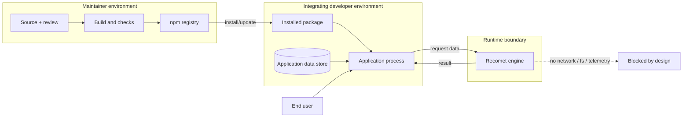

# Recomet Security Policy and Threat Model

**Status:** Phase 1 implemented and verified locally. Phase 2 accepted by the maintainer
(2026-11-05; independent audit `APPROVE WITH CONDITIONS`; documented limitations remain visible).
Phase 3 collaborative filtering (collaborative-only) is **accepted** by the maintainer (2026-11-07).
Phase 4 explicit `hybrid` strategy (implemented subset) is **formally accepted** by the maintainer
(2026-11-07), subject to documented limitations; hybrid personalization (`R23`) remains deferred
unless separately approved. Historical evidence is preserved in [`docs/development/phase-history/`](./docs/development/phase-history/).
**Last updated:** 2026-11-07
**Applies to:** Recomet core packages, build tooling, release artifacts, and documentation

---

## 1. Security Principles

Recomet is designed to process content metadata and potentially sensitive preference data
inside applications. Security is therefore a design requirement, not a feature.

1. **Least capability.** Runtime code has no network, filesystem, process, timer, or
   evaluation capability.
2. **Untrusted input.** Every public input is validated as if it came from an attacker, even
   when the integrating application considers it trusted.
3. **Bounded work.** Every variable-size input has explicit limits; no input may cause
   unbounded CPU, memory, recursion, or output.
4. **Fail closed and safely.** Invalid input produces a typed error; no partial results and
   no unsafe fallback.
5. **No secret material.** The library needs no keys, tokens, credentials, or environment
   configuration.
6. **Minimal dependencies.** Zero runtime dependencies is the target; each dev dependency is
   reviewed and locked.
7. **No hidden channels.** No telemetry, logging, error reporting, or runtime network calls.
8. **Review before release.** Security checks and privacy invariants are release blockers.

---

## 2. Assets

| Asset | Why it matters |
| --- | --- |
| Application content metadata | May be proprietary or sensitive. |
| End-user identifiers and preference signals | Personal data; remains application-owned. |
| Recommendation availability | Unbounded work could degrade or crash the host app. |
| Package integrity | Tampered code could exfiltrate data or attack hosts. |
| Developer trust | A privacy or security failure undermines the project's purpose. |
| Maintainer accounts and release pipeline | Compromise could distribute malicious updates. |

Recomet does not hold accounts, servers, databases, or hosted user data. The primary assets
are the package supply chain and correct local processing.

---

## 3. Trust Boundaries



### Boundary 1: npm registry → developer

- Network access occurs during package installation/update.
- npm account and registry security are external; Recomet mitigates with review, lockfiles,
  provenance where available, and no install scripts.
- Runtime behaviour after installation must not initiate network calls.

### Boundary 2: application → Recomet engine

- This is the primary attack surface.
- Data may originate from end users, imported datasets, third-party feeds, or application
  bugs. All of it is untrusted.
- The engine must not execute code from data, mutate prototypes, or allocate without bounds.

### Boundary 3: Recomet engine → operating system

- There is deliberately no boundary to filesystem, network, subprocesses, environment
  variables, or timers.
- Any future adapter that crosses this boundary requires a separate security review and
  must be opt-in.

### Boundary 4: end user → application

- Consent, legal basis, data retention, and end-user controls belong to the integrating
  application.
- Recomet cannot enforce how the host application handles data outside its process.

---

## 4. Threat Model

### 4.1 Actors

- **External attacker** supplying crafted content or interaction data through a vulnerable
  application.
- **Malicious or compromised dependency** attempting data exfiltration or code execution.
- **Attacker with npm package/account access** attempting to publish a malicious update.
- **Curious or careless integrator** passing excessive data or misconfiguring limits.
- **Insider risk in release process** mitigated by review and reproducible artifacts.

### 4.2 Threats and mitigations

| ID | Threat | Impact | Mitigations |
| --- | --- | --- | --- |
| T1 | Prototype pollution through `__proto__`, `constructor`, or `prototype` keys | Engine or host corruption, logic bypass | Reject those keys at every depth; use `Set`/`Map` for IDs; no untrusted deep merge; own data descriptors only; null-prototype internal option objects. |
| T2 | Unsafe object traversal triggers getters or proxy traps | Code execution in host context, unexpected data, or blocking | Validate own data descriptors; reject accessor properties; never invoke user getter accessors or `toJSON`; catch sanitized failures. Proxies cannot be reliably detected or safely inspected, and traps may execute host code, throw, mutate globals, or block. JSON-compatible input is the supported boundary for untrusted data; containment is not guaranteed. |
| T3 | Huge item/exclusion arrays or long IDs | Memory or CPU exhaustion | `maxItems`, `maxExcludeItemIds`, `maxIdLength`, total attribute budgets; reject before allocation. |
| T4 | Deeply nested or huge attributes | Stack overflow, memory exhaustion | Depth/node/string/total budgets; iterative traversal; no recursive unbounded walk. |
| T5 | Cycles or shared references in attributes | Infinite traversal | Reject cycles/shared references with a `WeakSet`; contract is a JSON tree. |
| T6 | Catastrophic regular expression backtracking | CPU denial of service | Avoid regex on untrusted input or use fixed, linear checks; no user-supplied patterns. |
| T7 | Error messages containing IDs, attributes, or user data | Privacy leakage via logs/UI | Value-free messages; paths limited to fixed field names and indexes; sanitized internal errors. |
| T8 | Accidental telemetry, analytics, or crash reporting | Privacy breach, trust loss | No telemetry code; dependency review; network-isolation tests; no logging. |
| T9 | Hidden runtime network or filesystem access | Data exfiltration | No Node built-ins in runtime; no `fetch`/XHR/WebSocket; bundle inspection; permission-restricted tests. |
| T10 | Compromised dev dependency or install script | Supply-chain attack on developer machines/CI | Pin and lock; minimal dev tooling; no install scripts; audit; review updates; provenance where available. |
| T11 | Malicious release artifact or npm account takeover | Host compromise | Maintainer MFA, minimal release rights, two-person review for releases, `npm pack` inspection, checksums/provenance where practical. |
| T12 | Unsafe dynamic code execution | Arbitrary code execution | No `eval`, `new Function`, string timers, or dynamic remote imports. |
| T13 | Denial through pathological candidate counts | Latency/availability | Bounded top-k heap O(`k`); bounded O(`n` + `e` + `a`) request tracking; hard `maxLimit`; total work budgets; benchmarks. |
| T14 | Host app misuses output as a security decision | Wrong access control or content exposure | Documentation states recommendations are advisory, not authorization. |
| T15 | Malicious input shapes (Symbols, BigInt, Dates, class instances) slip through | Unexpected behaviour in host or future code | Strict JSON-compatible contract; reject unsupported types; `unknown` at boundaries. |
| T16 | Logs or stack traces leak data | Privacy leakage | Library never logs; internal errors sanitized; stack available only as normal Error metadata locally, not in messages. |
| T17 | Prototype-less bypass: `Object.create(null)` inputs | Host incompatibility or inconsistent validation | Accept plain null-prototype records as data where safe; normalize without merging into prototypes. |
| T18 | Resource limit bypass through configuration | Attacker or careless dev raises caps | Absolute hard ceilings not configurable; config itself validated. |

### 4.3 Non-goals and residual risks

- Recomet cannot secure the host application, its transport, authentication, storage, or
  rendering.
- Recomet cannot prevent a host from logging or transmitting Recomet results.
- JavaScript proxies may execute traps during inspection; engines generally cannot inspect
  proxies without running host code. Recomet does not use `eval` or execute data as code, but
  it cannot guarantee containment of hostile objects. See §4.4.
- Protection against a compromised maintainer account is procedural, not cryptographic.
- Recommendations are not a security control; they must not gate authorization, billing, or
  access to private content.
- Phase 1's neutral baseline cannot be "manipulated" into leaking data; later ranking
  capabilities will require manipulation and fairness review.

### 4.4 JavaScript object-inspection boundary

Recomet's validation is designed for **JSON-compatible data**, not for arbitrary JavaScript
objects. This boundary must be stated accurately in security documentation and must not be
described as complete proxy containment.

- A JSON-parsed value consists of plain objects, arrays, strings, finite numbers, booleans,
  and `null`. These are the supported inputs for untrusted external data.
- A JavaScript `Proxy` can intercept property access, descriptor lookup, key enumeration, and
  other inspection operations. There is no standard, reliable way to detect an arbitrary proxy
  or to inspect it without running its traps. Hostile traps can execute arbitrary host code,
  throw, mutate global state, or block indefinitely.
- Recomet reads own data descriptors, avoids getter accessors and `toJSON`, and converts
  inspection failures to sanitized `INTERNAL_ERROR` errors. This reduces accidental execution
  and prevents raw error leakage. It does **not** guarantee protection against arbitrary code
  execution or blocking caused by a hostile object, because the inspection itself can run trap
  code.
- Applications that accept untrusted external input must make it JSON-compatible before passing
  it to Recomet — for example, by parsing JSON text in the host application and discarding
  exotic objects. Applications that pass live, arbitrary JavaScript objects remain responsible
  for that boundary.
- Tests may verify sanitized error reporting and documented behaviour. They must not claim to
  prove that a hostile proxy was contained.
- Phase 1 uses strict prototype checks. Arrays and plain objects created in a different realm
  (for example another `iframe` or `vm` context) are rejected as invalid input. Callers must
  pass values created in the current realm; this is a documented limitation, not a security
  guarantee.

---

## 5. Public Interface Security

### 5.1 Attack surface inventory

| Entry point | Exposed to | Controls |
| --- | --- | --- |
| `createRecommender(config?)` | Developer code, possibly config from env/user | Allowlisted keys; type/range checks; hard caps; frozen resolved config; synchronous safe failure. |
| `recommender.recommend(request)` | Application data, potentially end-user-supplied | Full envelope/item/attribute/preference validation; limits; deterministic bounded processing; typed errors. |
| Exported types | Compile-time only | No runtime effect; documented semantics. |
| `RecometError` | Caller code | Stable codes/categories; value-free details. |
| Package entry point | Node.js/browser bundlers | ESM entry, no side effects, no install scripts, no runtime deps. |

No other public runtime functions are exposed. No debug hooks, global
configuration, event emitters, or hidden classes are exposed.

### 5.2 Input validation requirements

All public inputs must satisfy:

- **Shape:** plain object, own enumerable string keys, no symbol keys, no accessors.
- **Allowlist:** unknown keys rejected, including nested config keys.
- **Preferences:** when present, `preferences` is a plain object with only an `interests` dense
  array. Each interest has an allowlisted `kind`, a bounded normalized string value, and an
  optional finite positive weight.
- **Types:** strings, finite numbers, booleans, nulls, arrays, plain objects only inside
  attributes; no functions, symbols, BigInt, Date, Map, Set, RegExp, typed arrays, or class
  instances. Mapped content signals accept a string or a dense array of strings only.
- **Identity:** IDs non-empty, bounded, no U+0000, unique within a request. Preference labels
  are non-empty after normalization and contain no U+0000.
- **Ranges:** `limit` integer within `1..maxLimit`; weights/scores finite and in range where
  applicable.
- **Budgets:** item count, exclusions, preference terms, preference value length, ID length,
  attribute depth, nodes, strings, total nodes, total characters, and mapped signal values
  per item.
- **Graph safety:** no cycles, no shared references, no prototype-pollution keys.
- **Supported boundary:** JSON-compatible values only for untrusted external data. Arbitrary
  live objects, including proxies, are outside the boundary and are not a safe way to pass
  hostile input; see §4.4.
- **No hidden hooks:** no `toJSON`, `valueOf`, getter accessors, or proxy-friendly merging.
  Proxy traps may still run during unavoidable inspection and can execute, throw, or block.

### 5.3 Safe processing rules

- Read only own properties via descriptors.
- Do not mutate input objects.
- Do not retain input references after a request.
- Use `Set`/`Map` for untrusted keys.
- Never `Object.assign`, spread, or deep-merge untrusted data into configuration or internal
  state.
- Catch unexpected errors and convert to `INTERNAL_ERROR` without including raw data.

---

## 6. Resource-Exhaustion Protection

### 6.1 Limits

Defaults and hard ceilings are defined in [ARCHITECTURE.md §8](./ARCHITECTURE.md#8-configuration-defaults-and-hard-caps).
They remain provisional. Phase 2 recorded synthetic time measurements on one reference machine:
the initial p95 budgets were met for 1,000 items/limit 10 and 10,000 items/limit 10 or 100 with
no attributes. Content workloads were measured without a time budget. Peak memory was not
measured, and the default total attribute budgets were not shown to fit attribute-heavy
payloads. No value is a validated performance or memory result. Key controls:

- Maximum items per request.
- Maximum exclusion IDs.
- Maximum returned results.
- Maximum explicit preference terms and preference label length.
- Maximum values read from one mapped content signal.
- Maximum ID length.
- Maximum attribute nodes per item, depth, string length.
- Maximum total attribute nodes and characters per request.
- Hard non-configurable ceilings on all configurable limits.
- Bounded top-k heap O(`k`), independent of item count, plus bounded O(`n` + `e` + `a` + `p`)
  request tracking.
- Early rejection before expensive traversal.

### 6.2 Work bounds

For a request with `n` items, `e` exclusion IDs, attribute work `a` (bounded by total
budgets), `p` normalized preference terms, and effective limit `k`, the engine performs:

- O(`n`) envelope/item validation, O(`e`) exclusion processing, O(`p`) preference
  normalization, plus O(`a`) attribute validation.
- O(`n`) candidate iteration and, when active, O(mapped signals) scoring per eligible item.
- O(`n` log `k`) top-k selection where `k ≤ 1,000`.
- O(`k` log `k`) final ordering.
- O(`k`) result allocation plus O(`k` × component count) explanation objects.

Auxiliary memory is O(`n`) duplicate-ID tracking, O(`e`) exclusion tracking, O(`a`)
attribute-graph tracking, O(`p`) normalized preferences, and O(`k`) top-k heap, plus the
returned result objects. Total auxiliary memory is O(`n` + `e` + `a` + `p` + `k`), excluding
caller-owned input and the returned result. It is **not** O(`k`) alone.

No algorithm in the current phases is quadratic in input size. Later phases must document
complexity and add limits for similarity, neighborhood, and profile sizes.

### 6.3 Failure behaviour

- Exceeding an item, exclusion, preference, or attribute budget throws a `RecometError` with
  `LIMIT_EXCEEDED` and no partial result.
- An invalid or out-of-range `limit` value throws `INVALID_LIMIT`; it is a malformed request
  parameter, not an exceeded collection budget.
- No truncation of the input; silently truncating could hide attacks or produce misleading
  recommendations.
- No retries, background cleanup, or partial processing.
- Callers control concurrency. The engine does not create queues, workers, or timers.

---

## 7. Dependency and Supply-Chain Security

### 7.1 Runtime dependencies

**Target: zero.** The core must use standard ECMAScript. A runtime dependency must not be
added without:

1. A written purpose and why native functionality is insufficient.
2. Alternatives considered, including implementing the small function internally.
3. Maintenance status, release cadence, and bus factor.
4. Known vulnerabilities and security history.
5. Install-script behaviour and transitive dependency footprint.
6. License compatibility with Apache 2.0.
7. Bundle-size and performance impact.
8. Maintainer approval recorded in the pull request.

### 7.2 Development dependencies

Allowed categories: TypeScript compiler, test runner, linting, formatting, browser test
runner, benchmark harness, bundle inspection.

Requirements:

- Lockfile committed and reviewed.
- No unnecessary transitive dependencies.
- No package with unexplained install scripts if avoidable.
- `npm audit` (or equivalent) run and reported before release.
- Updates reviewed, not blindly bumped.
- Dev dependencies never shipped in the runtime package.
- A dev dependency compromise is still treated as a security incident for maintainer
  machines and CI.

### 7.3 Release integrity

- Build from a clean checkout with a locked toolchain.
- Inspect `npm pack --dry-run` / packed tarball contents.
- Verify no source maps expose local absolute paths or secrets.
- Verify no test fixtures, local data, `.env`, logs, or credentials are packaged.
- Use npm 2FA and least-privilege publishing.
- Require two-person review for releases where the maintainer roster allows.
- Publish provenance/attestations when tooling supports it; do not claim provenance before
  it is configured.
- Never publish from a personal machine with uncommitted changes.

### 7.4 Install-time behaviour

- No `preinstall`, `install`, or `postinstall` scripts.
- No binaries, native compilation, or downloads during install.
- Installation uses npm registry access only; this is distinct from runtime.

---

## 8. Error-Handling Principles

1. Fail before work, not midway.
2. Use stable machine-readable codes; do not require message parsing.
3. Never include input values in errors.
4. Distinguish configuration, validation, limit, and internal errors.
5. Do not swallow errors silently.
6. Do not return partial results on failure.
7. Do not log errors.
8. Do not expose stack traces, file paths, or environment details in messages.
9. Preserve a normal `Error` stack locally for debugging, but never attach raw input.
10. Convert unexpected failures to a generic internal error without leaking details to the
    caller.

Example safe message:

```text
Invalid recommendation limit (INVALID_LIMIT)
```

Unsafe examples that must not appear:

```text
User user-123 has invalid interest "medical-condition"
Item title "Private document" is malformed
Config secret abc123 is invalid
```

---

## 9. Secure Coding Standards

- TypeScript `strict` mode; no `any` at public boundaries.
- Validate `unknown` input; do not cast unvalidated data.
- Prefer immutable data and `readonly` types.
- No global mutable state.
- No `eval`, `Function`, string-based timers, `vm`, or dynamic remote imports.
- No filesystem, network, child process, worker, or environment access in `src/`.
- No secrets, tokens, URLs, or credentials in source or tests.
- No user-controlled regular expressions.
- No recursive traversal without a depth bound.
- No unbounded arrays, maps, caches, or queues.
- Use constant-time irrelevant here; no authentication or secrets exist.
- Treat all exported functions as security boundaries.
- Document residual risks rather than claiming absolute safety.

---

## 10. Security Testing Requirements

### 10.1 Required test cases

**Input shape and type attacks**

- Request is `null`, array, string, number, symbol, function, class instance, Date.
- Unknown top-level and nested config/content/preference keys.
- Items not an array; sparse arrays; array holes; oversized arrays.
- Limit as string, float, negative, zero, `NaN`, `Infinity`, above maximum.
- Preferences malformed, missing interests, sparse, cyclic, oversized, or containing unknown
  kinds, invalid labels, or invalid weights.
- Item missing ID; empty ID; non-string ID; overlong ID; NUL in ID.
- Duplicate IDs, including Unicode lookalikes and case variations (must be treated as
  distinct or duplicate exactly as specified, never normalized).
- Exclusions not an array; non-string entries; oversized list; duplicates.
- Mapped content signals that are not a string or dense string array.

**Prototype pollution**

- `__proto__`, `constructor`, `prototype` keys at root, nested objects, preferences, interests,
  and arrays of objects.
- `Object.create(null)` payloads.
- Objects with own `__proto__` data property.
- Payloads that attempt to mutate `Object.prototype` and verification that globals remain
  unchanged after rejection.
- Crafted `toString`, `valueOf`, and `toJSON` properties that must not execute.

**Accessors and exotic objects**

- Getter/setter properties in requests, items, config, preferences, and attributes.
- Proxy-wrapped objects. Tests verify sanitized error reporting and documented behaviour only;
  they must not claim that a hostile proxy was contained. Traps may run, throw, or block
  during inspection (see §4.4).
- Symbols, BigInt, functions, Maps, Sets, RegExps, typed arrays, ArrayBuffers.

**Resource exhaustion**

- Item count above `maxItems`; exclusions above cap; preference terms above cap.
- Attribute depth above cap; nodes above per-item cap; mapped signal values above cap.
- Total nodes/characters above request cap.
- Cyclic and shared-reference attributes.
- Long strings, keys, and preference labels.
- Large `limit` above cap.
- Verify early rejection and bounded memory in tests/benchmarks.

**Error safety and privacy**

- All error messages and serialized errors contain no input IDs, attribute values, preference
  labels, or user data.
- Results contain no preference labels or content labels.
- Internal failures are sanitized.
- No console output, no captured logs, no network attempts.

**Regression**

- Every fixed vulnerability gets a regression test that fails before the fix.

### 10.2 Compatibility and privacy tests

- Run core tests on Node.js minimum and current versions.
- Run built ESM in real browsers and report per engine/browser. A WebKit-based headless runner
  is not Safari verification; Safari must be tested in Safari or reported unverified.
- Static check that runtime source contains no `fetch`, XMLHttpRequest, WebSocket,
  `node:`, `process`, `fs`, or eval.
- Network-isolation test (process without network access) for the core suite.
- Packed tarball inspection for unexpected files and install scripts.

### 10.3 Verification evidence (2026-11-05)

Recorded local results on Node.js `v24.18.0` (reference runtime) and Node.js `v22.23.4`
(temporary-runtime compatibility check; not a permanent project dependency), Windows x64:

- **Automated suite:** 197 tests across 12 files (current Phase 2 verification snapshot)
  passed on both Node.js runs, and the type check passed on both. Coverage includes malformed
  requests, configuration, and preferences; accessors; symbols; exotic objects;
  prototype-pollution keys; cycles; shared references; resource budgets; duplicate IDs;
  exclusions; mapped-signal validation; content scoring and explanations; result privacy; input
  mutation and retention; instance isolation; hostile Proxy behaviour; and a naive
  reference-implementation comparison. Historical Phase 1 verification recorded 136 tests
  across 9 files.
- **Static policy scan:** `src/**/*.ts` contains only relative imports and no `node:`, `fetch`,
  XMLHttpRequest, WebSocket, storage API, `process`, `eval`, `new Function`, dynamic import, or
  other network/filesystem/subprocess capability. `package.json` declares zero runtime
  dependencies, ESM, Node `>=22`, and the intended packed-file allowlist.
- **Quality commands:** `npm run verify` passed typecheck, lint, format check, 197 tests, and
  build. `npm pack --dry-run --json` contained only the ESM build, declarations, `package.json`,
  `LICENSE`, and `README.md`.
- **Browsers:** Edge `156.0.4314.58`, Chrome `156.0.8078.80`, and Firefox `160.0` each passed
  18/18 checks. Safari and WebKit remain unverified.
- **Audit:** `npm audit --omit=dev` reported 0 vulnerabilities. The full development-dependency
  audit reported 10 moderate findings, 0 high, and 0 critical; the tracked moderate advisory is
  recorded in §10.3a. No runtime dependency is shipped.
- **Not performed:** peak-memory profiling, an OS-level network-disabled execution of the test
  suite, Safari/WebKit execution, recommendation-quality evaluation, or published-package
  verification. These remain release or follow-up actions and are not implied by the results
  above.
- **Residual risk:** hostile Proxy traps may execute, throw, or block during inspection.
  Sanitized errors do not prove containment. JSON-compatible input is the supported
  untrusted-data boundary.

### 10.3a Development dependency advisory (tracked, open)

| Field | Value |
| --- | --- |
| Advisory | `GHSA-g3hv-75wg-m249` (GitHub Security Advisory) |
| Package | `minimatch` |
| Audited version (recorded 2026-11-05) | `10.2.6` |
| Severity | Moderate |
| Issue | Regular-expression denial of service / glob-pattern amplification |
| Dependency context | Development dependency chain: `eslint` and `typescript-eslint` tooling (`@typescript-eslint/typescript-estree` / related lint tooling paths). Not a runtime dependency of `@recomet/core`. |
| Runtime impact | No runtime dependency impact identified. The published/runtime package declares zero runtime dependencies and the advisory applies to development tooling. |
| Current audit result | `npm audit --omit=dev`: 0 vulnerabilities. Full `npm audit`: 10 moderate findings, 0 high, 0 critical. |
| Status | **Open / not fixed in this task.** The issue remains open until a verified, compatible resolution is available and reviewed. |
| Follow-up | Investigate a compatible, reviewed dependency update in the ESLint/typescript-eslint chain. Do not run `npm audit fix`, `--force`, `--legacy-peer-deps`, or unrelated dependency upgrades as part of this tracking update. Do not modify `package.json` or `package-lock.json` until a reviewed resolution is identified. |

### 10.4 Later phases

- Ranking manipulation tests for future capabilities.
- Fuzzing/property-based tests for validators and ranking math.
- Dataset poisoning and adversarial interaction tests for collaborative filtering are partially addressed by Phase 3 validation/synthetic tests; broader poisoning/resilience evaluation remains later-phase work. Phase 3 interaction records are explicitly supplied per call, strictly validated/bounded, processed in memory only, and never retained/transmitted.
- Manipulation, bias, and fairness evaluation for ranking.
- Memory profiling at documented scale.

---

## 11. Vulnerability Reporting and Response

### 11.1 Reporting

- The intended channel is GitHub private vulnerability reporting / Security Advisories for the
  repository: `https://github.com/arjunuxd/recomet/security/advisories/new`.
- **Availability must be verified in the repository settings before this channel is described as
  active.** If private reporting is not enabled, do not publish vulnerability details in a
  public issue; contact the repository owner through GitHub and wait for a private channel to be
  established.
- Do not open a public issue for an undisclosed vulnerability.
- Include affected version/commit, impact, reproduction steps using synthetic data, and any
  suggested fix.
- Do not include real end-user data, secrets, or personal information in reports.
- No maintainer email address is invented or published in this document; if one is added
  later, it must be a monitored security contact.

### 11.2 Response targets

No response-time guarantee is made. The project is maintained on a best-effort basis, and
maintainers must not promise times they cannot keep.

When a report is received, maintainers will:

1. Acknowledge it privately as capacity allows.
2. Triage severity and affected versions.
3. Prepare and review a fix, with a regression test where applicable.
4. Coordinate disclosure with the reporter.

If a response is delayed, maintainers should communicate the constraint rather than imply a
commitment that does not exist.

### 11.3 Process

1. Acknowledge privately and restrict details.
2. Reproduce with synthetic data in a controlled environment.
3. Assess affected versions and severity (for example CVSS).
4. Develop and review a fix; add a regression test.
5. Prepare an advisory and release notes without exposing user data.
6. Release a patched version; coordinate disclosure.
7. Update dependencies or documentation if the cause is procedural.
8. Record lessons learned where appropriate.

### 11.4 Scope

In scope: Recomet source, build/release configuration, packaged artifacts, documented
privacy/security guarantees.

Out of scope unless caused by Recomet: vulnerabilities in the host application, npm
registry compromise, browser/Node.js platform bugs, misconfiguration by the integrator,
and issues requiring access to a developer's private data store.

---

## 12. Security Release Gates

A release must not ship unless:

- All Phase security tests pass.
- No known high/critical vulnerability affects shipped runtime code.
- Runtime dependency count is zero, or every dependency has recorded review.
- No install scripts or unexpected packed files.
- Privacy invariants are verified (no telemetry/network/persistence code).
- Error paths are checked for sensitive data.
- Resource limits are effective and tested, and are documented as provisional until validated by
  recorded benchmarks; no unverified performance or memory claim is published.
- Documentation describes security and privacy behaviour accurately.
- A maintainer other than the author has reviewed security-relevant changes.
- Any unresolved risk is documented and explicitly accepted by maintainers.

---

## 13. Related Documents

- [PRIVACY.md](./PRIVACY.md) — data flows, telemetry prohibition, verification.
- [ARCHITECTURE.md](./ARCHITECTURE.md) — modules, validation flow, limits.
- [SPECIFICATION.md](./SPECIFICATION.md) — requirements and success criteria.
- [CONTRIBUTING.md](./CONTRIBUTING.md) — review and release governance.
