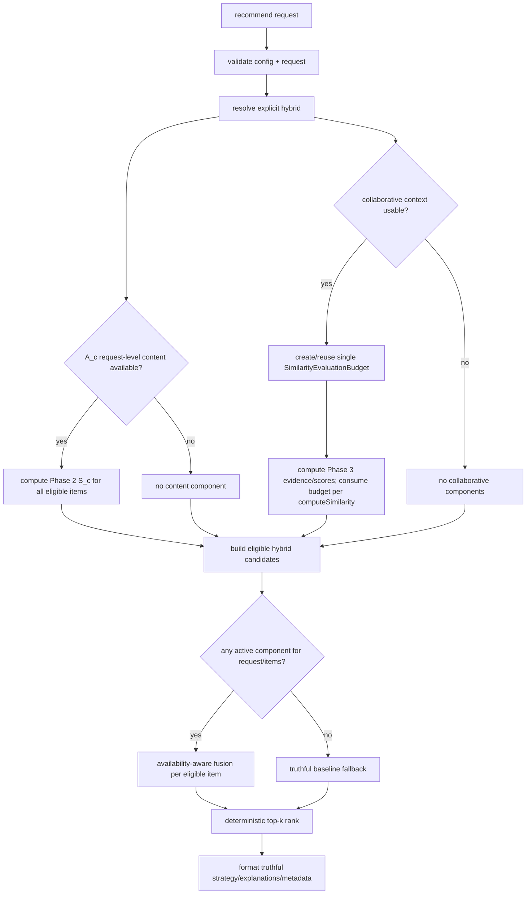

# Phase 4 Architecture — Hybrid Recommendation Engine (Planning, Decisions Resolved)

**Status:** **Design decisions resolved (2026-11-07). Planning complete; not implemented, not started.**  
**Foundation:** Accepted Phase 1–3 implementation/architecture. Requirements: `PHASE4_SPECIFICATION.md`.

## 1. Goals and constraints

- Add **explicit `hybrid`** as a modular strategy; keep `baseline`, `content`, `collaborative`, and **`auto` behavior exactly unchanged**.
- Availability-aware fusion: missing collaborative evidence is not synthesized as zero; neither-signal requests fall back to baseline with truthful reporting.
- Rank **all eligible request items** (including content-only items without CF evidence), preserving exclusions and previously interacted-item behavior.
- Reuse **one request-scoped collaborative similarity-evaluation budget** (`maxCollaborativeSimilarityEvaluations`) for all collaborative similarity work; never reset/replenish.
- Local in-memory only; zero runtime deps; no network/telemetry/persistence; no caller-input mutation/retention; no module-global mutable request state; no sensitive data in outputs/errors.

## 2. Current integration points (verified)

| Area | Current responsibility | Phase 4 integration |
|---|---|---|
| `contracts/config` / `validation/config` | Strategy/config/limits allowlists + bounds | Add `hybrid` strategy and `hybrid.weights` config; recommend/document `HYBRID_WEIGHT_MAX` (planning recommends 1000, final bound confirmed at implementation). Reject both-zero weights. |
| `contracts/result` | `StrategyId`, components, metadata | Review additive changes for `hybrid` and safe hybrid explanation factors. Document TS exhaustive-switch compatibility impact. |
| `validation/request` | Validation, signal detection, model building, strategy resolution | Resolve explicit `hybrid`; detect request-level content availability and collaborative context. Build interaction model/content signals only when needed. Preserve existing `auto` path exactly. |
| `engine/pipeline` | Attempts, budget creation, fallback, formatting | For explicit `hybrid`, create/reuse single similarity budget when CF may run; orchestrate fusion or truthful fallback. No budget reset. |
| `candidates/content` | Per-item Phase 2 scores/components | Reuse scoring semantics to obtain `S_c(i)` for eligible items when content available. |
| `candidates/collaborative` + `collaborative/*` | Phase 3 evidence/scores, actual `computeSimilarity` gating | Reuse to obtain `A_f(i)`/`S_f(i)` from actual evidence; all `computeSimilarity` calls consume shared budget. |
| `ranking/score`, `ranker` | Combine/rank/format | Add safe hybrid composition/explanations; keep finite `[0,1]`, deterministic tie-breaks. |

## 3. Conceptual execution flow (explicit `hybrid`)

*Conceptual only. Implementation must avoid redundant collections/passes while preserving semantics.*

## 4. Per-item fusion data model (conceptual)

For each eligible item `i` (not excluded; respecting previously interacted-item eligibility rules):
- `S_c(i)`, `contentAvailable = A_c` (request-level)
- `S_f(i)` only if valid collaborative evidence exists; else `hasCfEvidence=false` (`A_f(i)=0`)
- `w_c`, `w_f` from validated config
- `S_h(i)` from availability-aware formula in `PHASE4_SPECIFICATION.md` §4.5

All eligible items remain rankable:
- both active => fuse actual `S_c(i)`, `S_f(i)`
- content only => `S_c(i)`
- CF only for item => `S_f(i)`
- neither active => item has no fused signal; request-level neither-signal case falls back to baseline (truthful).

## 5. Budget lifecycle

1. Validate request/config.
2. If explicit `hybrid` and collaborative context may run, create **one** `SimilarityEvaluationBudget(maxCollaborativeSimilarityEvaluations)`.
3. Pass same budget to all collaborative similarity work (no alternate paths).
4. Every actual `computeSimilarity` invocation consumes one unit via existing guard pattern.
5. Never reset/replenish. Deterministic exhaustion behavior preserved from Phase 3.

## 6. Explanation architecture (safe)

Hybrid explanations must clearly represent content and collaborative contributions without sensitive data:
- Identify applied factors/components (e.g., content-side contribution/factors and collaborative contribution) and actual global/normalized weights or contributions as safe aggregates.
- Do **not** include raw preference labels/values, user IDs, interaction records, or sensitive payloads.
- Strategy/summary must be truthful when fallback occurs.

Final public schema (names/shape) is an implementation-time contract decision; it must be additive/reviewed and documented.

## 7. Error handling and validation

- Reuse `RecometError` categories and value-free safe details.
- Hybrid config errors: invalid weights (type/finite/negative/>max), both-zero config.
- Hybrid request/signal handling: follow existing validation rules; do not invent hidden defaults that change privacy/behavior.

## 8. Performance and memory

- Avoid duplicate full candidate collections where a merged eligible-item pass is sufficient.
- Do not recompute identical content/CF results unnecessarily.
- Respect existing limits; similarity budget bounds only actual `computeSimilarity` invocations, not all CPU/memory.
- Keep intermediate structures request-scoped and minimal.

## 9. Compatibility

- `auto` preserved exactly (Decision 1).
- Existing strategies unchanged.
- `hybrid` explicit; document TS exhaustive-switch/type compatibility implications (Decision 6).
- No dependency/runtime portability regressions.

## 10. Implementation sequence (after separate authorization)
1. Finalize contract/schema names for hybrid explanation components and truthful fallback strategy labels.
2. Config/types/validation (including hard limit chosen per recommendation).
3. Request resolution for explicit `hybrid`.
4. Fusion helpers + golden vectors (all availability combinations).
5. Pipeline integration with shared budget.
6. Explanations/formatting + privacy checks.
7. Unit/integration/regression/security/determinism/perf verification.
8. Docs/acceptance evidence/maintainer review.

No steps started in this planning task.
